# MacSweep

<p align="center">
  
</p>

<p align="center">
  <strong>Native macOS Application Uninstaller, Startup &amp; Extension Manager, Leftover Cleaner, File Manager, Junk Cleaner &amp; Resource Release Suite built with pure Swift, SwiftUI &amp; AppKit</strong><br>
  <strong>基于纯 Swift、SwiftUI 与 AppKit 构建的原生 macOS 应用卸载、启动项与扩展管理、残留清理、文件管理、垃圾清理与资源释放工具</strong>
</p>

<p align="center">
  <a href="#english-documentation">English</a> ·
  <a href="#简体中文文档">简体中文</a> ·
  <a href="./README_EN.md">README_EN.md</a> ·
  <a href="./README_ZH.md">README_ZH.md</a> ·
  <a href="./docs/PLANNING.md">Planning &amp; Roadmap</a> ·
  <a href="./LICENSE">MIT License</a> ·
  <a href="./SECURITY.md">Security Policy</a>
</p>

---

## 简体中文文档

**MacSweep** 是一款面向 macOS (Apple Silicon / Intel) 的原生系统清理、文件管理与资源释放工具。项目完全采用 **Swift 6 + SwiftUI / AppKit + SwiftPM** 构建，**零第三方运行时依赖、零后台常驻进程、零网络遥测**，从命令行工具链（Xcode Command Line Tools）即可直接编译打包，无需安装完整 `Xcode.app`。

### 核心特性（7 大功能页签）

1. **应用程序（彻底卸载 / 重置应用 / 批量清理 / 拖放快卸）**
   - **一次性内存索引 + `pkgutil` 懒查**：启动扫描时通过 `LibraryIndex` 一次性扫描用户与系统 `Library` 目录，并结合 `pkgutil` 安装收据懒加载关联 Caches、Preferences、Application Support、Containers、Group Containers、Saved Application State、HTTPStorages、WebKit、Cookies、Logs、LaunchAgents / LaunchDaemons 与 PrivilegedHelperTools 等全部服务文件。
   - **渐进式异步体积计算**：内置限流目录测算器（`DirectorySizer`），支持按体积分组折叠、按名称/体积/最近使用/修改时间排序与实时搜索。
   - **卸载与重置双模式**：既可完整卸载应用本体与服务文件，也可切换至「重置」模式仅清空配置与缓存（并在成功后通过 `defaults delete` 刷新 `cfprefsd` 内存缓存）。
   - **安全防护细节**：自动识别共享同一 Bundle ID 的多副本应用（默认不勾选共享服务文件）、过滤通用运行时可执行文件名与跨应用重名冲突、拖放任意 `.app` 到窗口或 Dock 图标快速分析、卸载运行中应用时优先温和退出而非静默强杀。

2. **启动程序（LaunchAgents / LaunchDaemons / 登录项）**
   - 统一扫描并按作用域分组展示 `~/Library/LaunchAgents`、`/Library/LaunchAgents`、`/Library/LaunchDaemons` 及应用内嵌登录项。
   - 结合 `launchctl print-disabled` 与 plist `Disabled` 字段还原真实启停状态，支持一键启停与 XML / 二进制 plist 内容预览。
   - 自动检测可执行文件已缺失的僵尸启动项（Broken / Orphaned），移除配置文件前自动执行 `launchctl bootout` 并校验服务确实已卸载（若服务仍存活则拒绝删除对应 plist）。

3. **扩展（浏览器扩展 / 应用扩展 / 系统插件）**
   - **浏览器扩展**：覆盖 Google Chrome、Microsoft Edge、Brave、Arc（解析 `manifest.json` 及 `__MSG_*__` 本地化名称）、Firefox（解析 `extensions.json` 用户配置扩展）与 Safari。
   - **第三方应用扩展（`.appex`）**：基于 `pluginkit -m -v` 展示与开关启用/禁用，禁止单独删除宿主包内嵌 `.appex` 以防破坏代码签名，同时支持一键跳转宿主应用完整卸载。
   - **系统插件**：涵盖偏好设置面板、QuickLook、Spotlight、屏保、互联网插件与音频插件（Components / VST / VST3 / HAL，并对 HAL 虚拟音频驱动标注重启提示）。
   - **权限优雅降级**：未授予完全磁盘访问权限时自动标注受限浏览器并提供一键直达系统设置的引导；移除 Chromium / Firefox 扩展前检测并提醒先退出对应浏览器。

4. **残留文件（孤立数据智能排查）**
   - 构建全机已安装应用指纹库（`InstalledAppInventory`，包含本地化 `InfoPlist.strings` 名称与 UUID 后缀匹配），并自动排除 macOS 内置 `launchd` 系统服务（如 `accountsd`）、Apple 系统组件、常见开发工具/CLI 目录（Homebrew、Xcode、Docker、Cargo、Node、Python 等）及共享厂商父目录。
   - 按 **高置信度（默认勾选）** 与 **建议核对（默认不勾选，含系统级目录与共享厂商 SDK）** 分级展示，支持单组永久忽略。

5. **文件管理（空间分析 + 通用文件浏览）**
   - **空间分析（`DiskSpaceAnalyzer`）**：展示卷容量条、目录占比条与面包屑下钻，支持大体积（`≥ 50 MB` / `100 MB` / `500 MB` / `1 GB`）与陈旧时间筛选；遍历严格跳过符号链接、遵循 `st_dev` 单卷边界、基于 `(st_dev, st_ino)` 对硬链接去重并跳过 `SF_DATALESS` 云端占位文件。
   - **通用文件浏览（`FileBrowserService` + `FileOperationsEngine`）**：提供常用位置侧栏、前进/后退/上级导航、隐藏文件切换（`⌘⇧.`）、多字段排序、搜索、原生 QuickLook（`Space`）与 `SafeFileReader` 限流安全预览检查器；支持受 `SafetyGuard` + TOCTOU 目录 FD 校验的移动、重命名、新建文件夹与废纸篓优先删除。

6. **垃圾清理（`JunkCacheScanner` 五大专项清理）**
   - 覆盖 **用户与应用缓存**（严格校验 `SafetyGuard.validateCacheSubpath`，自动跳过 Apple 缓存及裸露的共享厂商根目录如 `Google` / `Adobe` / `Microsoft` / `JetBrains`）、**日志与崩溃报告**（系统级日志默认不勾选）、**浏览器缓存**（仅清理缓存子目录且运行中浏览器强制拦阻）、**开发者缓存**（Xcode DerivedData / CoreSimulator / Homebrew / npm / pnpm / pip / cargo，`Xcode Archives` 默认不勾选）与 **废纸篓内容**。

7. **资源释放（大文件 / 三阶段重复文件 / 实时内存释放）**
   - **大文件排查**：按阈值（`≥ 50 MB`–`1 GB`）、陈旧天数、文件类型与关键词检索，并支持右侧检查器与一键加入保护名单。
   - **三阶段 SHA-256 重复文件**：体积分组（去重硬链接、忽略 0 字节/符号链接/`SF_DATALESS`）→ 首尾局部哈希 → 流式 `CryptoKit.SHA256` 全量校验；内置「智能选择（优先保留非下载目录/最早/最新/最短路径）」及防全删二次确认。
   - **实时内存监控与诚实释放（`MemoryReleaseService`）**：基于 Darwin/Mach `host_statistics64` 与 `vm.swapusage` 实时采样 Active / Wired / Compressed / Cached / Free / Swap 与压力等级；提供非提权标准压力整理与可选管理员提权 `/usr/sbin/purge`，并如实展示释放前后差值。

8. **安全架构、保护名单与原生体验**
   - **废纸篓优先与 `SafetyGuard`**：默认移至废纸篓并保留 macOS「放回原处」；支持在「设置 → 保护名单」直接管理 `protectedPaths`（路径屏蔽名单）、`protectedBundleIDs` 与忽略残留项；所有删除与文件变更均经过三重路径解析与 TOCTOU 父目录锁校验。
   - **原生视觉与双语**：内置「深海蓝暗色（默认）」与「跟随系统浅/深色」主题、简体中文 / English 即时切换、清理历史记录（最多保留 100 条并支持展开精确路径）。

### 界面预览（Visual Showcase）

以下全部界面截图均由内置脱敏演示模式（`--demo-mode --export-screenshots`，虚构用户 `/Users/alex` 与合成图标）以 2x Retina（`2240×1400`）自动导出，绝不包含宿主机个人数据：

<table>
  <tr>
    <td align="center" width="50%">
      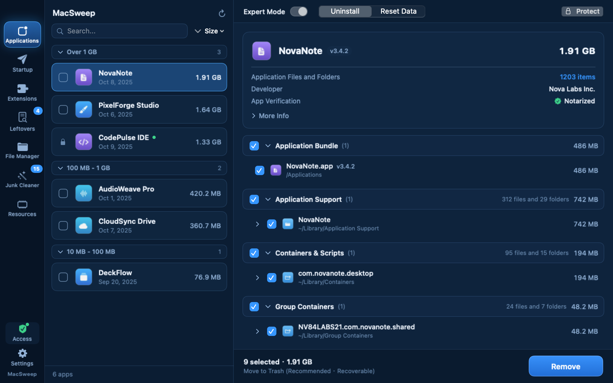<br>
      <sub><b>Applications</b> — 分桶体积、服务文件与卸载/重置模式</sub>
    </td>
    <td align="center" width="50%">
      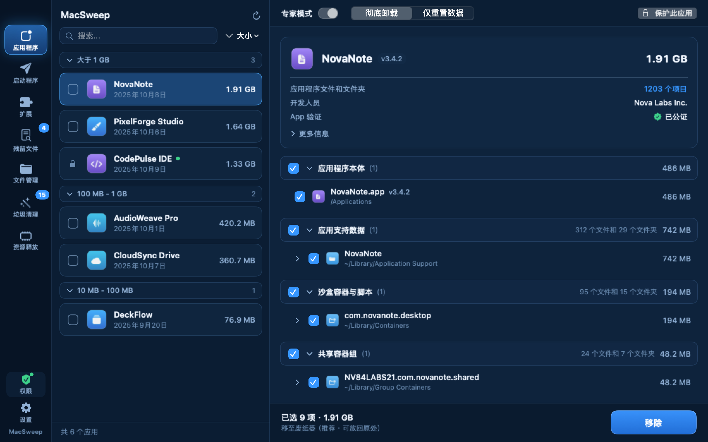<br>
      <sub><b>简体中文界面</b> — 原生双语深海蓝主题</sub>
    </td>
  </tr>
  <tr>
    <td align="center" width="50%">
      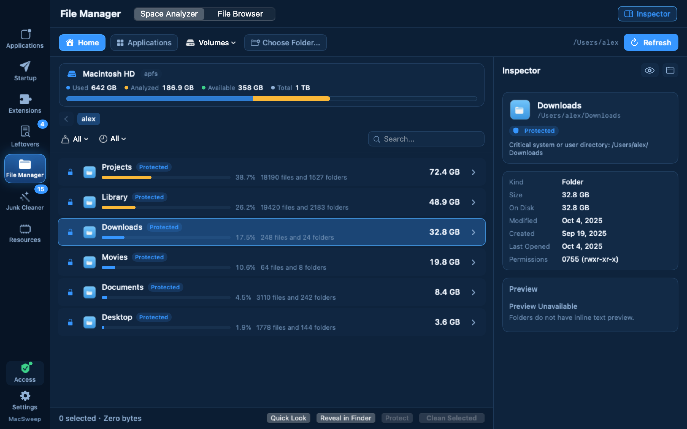<br>
      <sub><b>File Manager (Space Analyzer)</b> — 卷容量条与目录占比下钻</sub>
    </td>
    <td align="center" width="50%">
      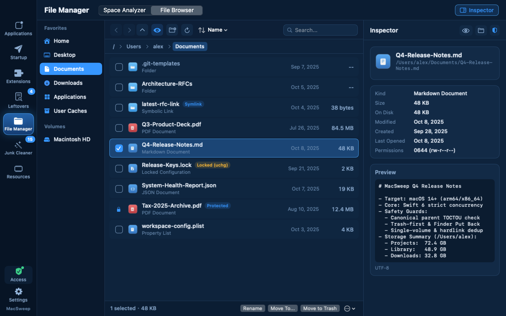<br>
      <sub><b>File Manager (File Browser)</b> — 安全文件浏览与限流内容预览</sub>
    </td>
  </tr>
  <tr>
    <td align="center" width="50%">
      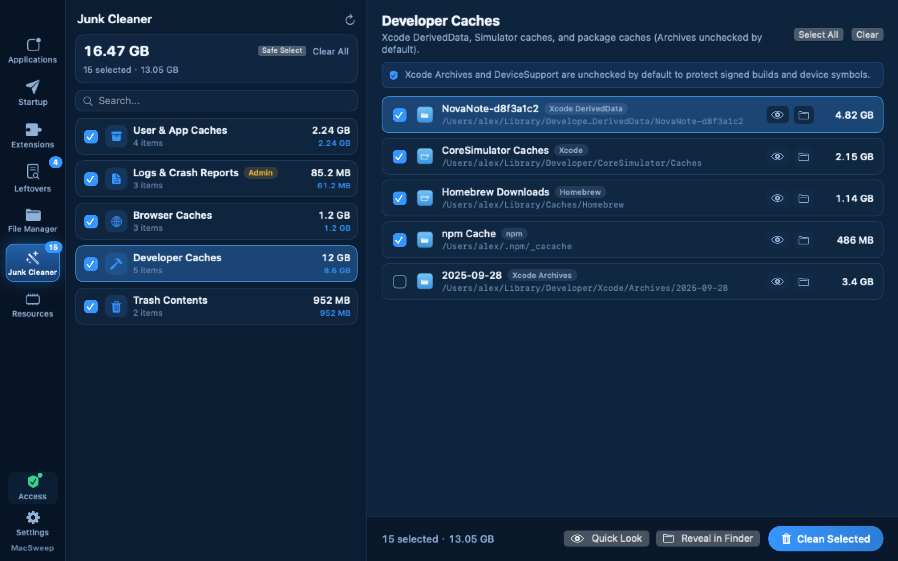<br>
      <sub><b>Junk Cleaner</b> — 五大缓存/日志/开发/废纸篓分类与安全隔离</sub>
    </td>
    <td align="center" width="50%">
      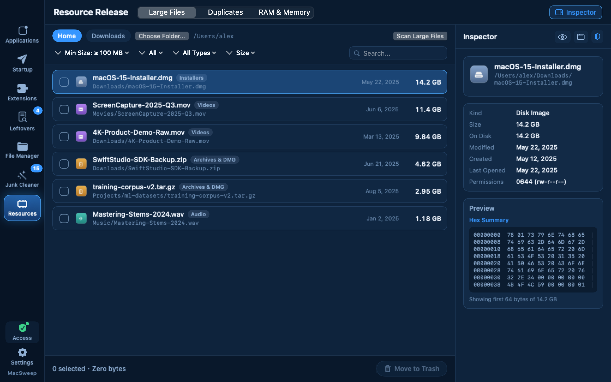<br>
      <sub><b>Resource Release (Large Files)</b> — 大体积与陈旧文件排查</sub>
    </td>
  </tr>
  <tr>
    <td align="center" width="50%">
      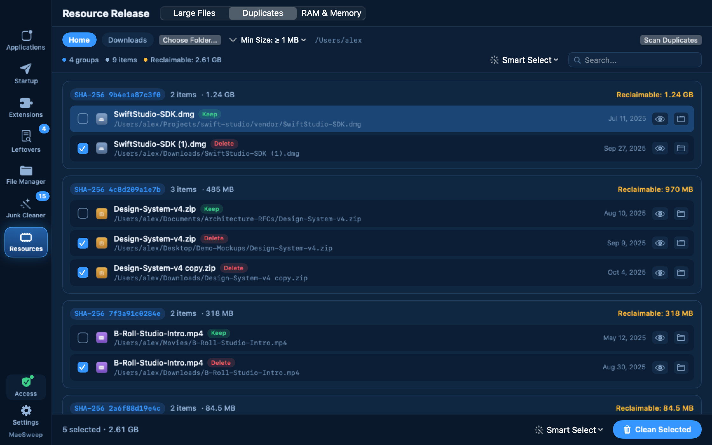<br>
      <sub><b>Resource Release (Duplicates)</b> — 三阶段 SHA-256 重复文件与智能保留</sub>
    </td>
    <td align="center" width="50%">
      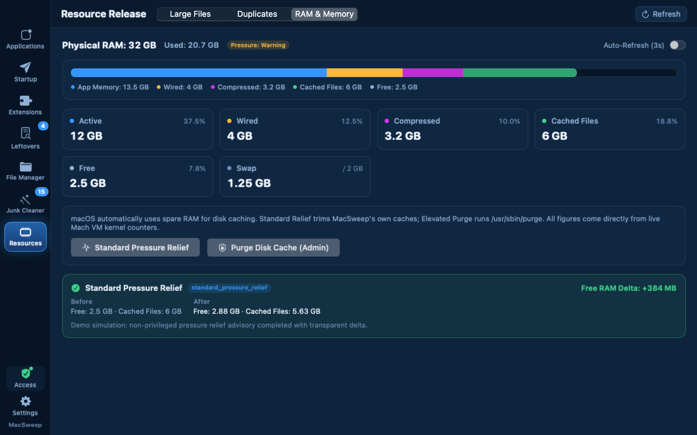<br>
      <sub><b>Resource Release (RAM &amp; Memory)</b> — Mach 内核采样与诚实释放</sub>
    </td>
  </tr>
  <tr>
    <td align="center" width="50%">
      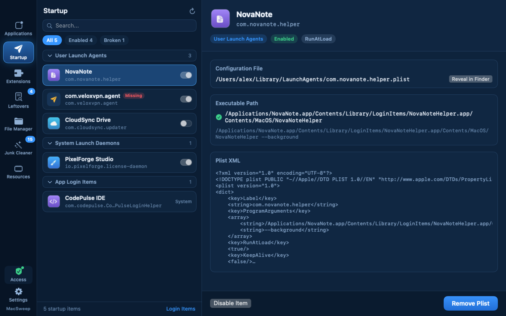<br>
      <sub><b>Startup Programs</b> — LaunchAgents/Daemons、僵尸检测与 Plist 预览</sub>
    </td>
    <td align="center" width="50%">
      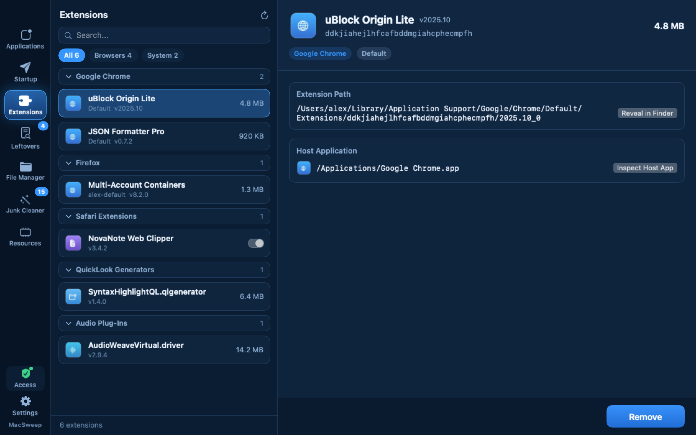<br>
      <sub><b>Extensions</b> — 浏览器扩展、.appex 与系统插件</sub>
    </td>
  </tr>
  <tr>
    <td align="center" width="50%">
      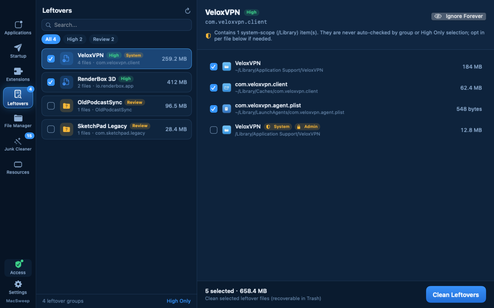<br>
      <sub><b>Leftovers</b> — 高置信度与系统级孤立残留排查</sub>
    </td>
    <td align="center" width="50%">
      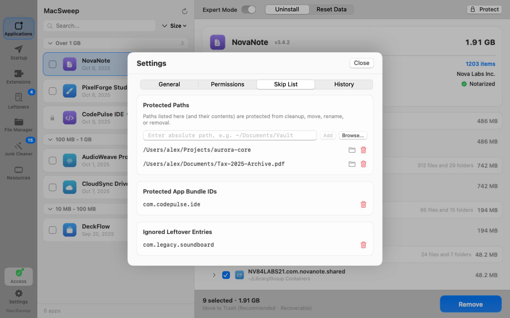<br>
      <sub><b>Settings · Skip List (Light Theme)</b> — 浅色主题与路径保护名单</sub>
    </td>
  </tr>
</table>

### 系统架构图

```text
┌────────────────────────────────────────────────────────────────────────────┐
│  Sources/MacSweepAppEntry/MacSweepApp.swift  Executable Entry (`MacSweepApp`)│
│  └── CLI/Env 演示解析 (--demo-mode / --export-screenshots) / Dock 拖放入口 │
├────────────────────────────────────────────────────────────────────────────┤
│  Sources/MacSweepApp/     原生 SwiftUI 界面层 (`MacSweepUI`, 7 大功能页签)  │
│  ├── Views/               Applications / Startup / Extensions / Leftovers  │
│  │                        FileManagerView / JunkCleanerView /              │
│  │                        ResourceReleaseView / SettingsSheet              │
│  ├── Components/          SidebarRail / FileInspectorView / QuickLook /    │
│  │                        AnalyzerCapacityComponents / ConfirmationSheet   │
│  └── State/               AppState / FileManagerStore / CleanupCenterStore │
│                           DemoScreenshotExporter / L10n / Theme            │
├────────────────────────────────────────────────────────────────────────────┤
│  Sources/MacSweepCore/    零依赖核心引擎库 (Swift 6 Sendable, 无 SwiftUI)   │
│  ├── Scanners/            LibraryIndex / AppScanner / ServiceFileMatcher   │
│  │                        DiskSpaceAnalyzer / FileBrowserService           │
│  │                        JunkCacheScanner / LargeAndDuplicateScanner      │
│  │                        StartupScanner / ExtensionScanner / Leftover     │
│  ├── Actions/             RemovalEngine / FileOperationsEngine             │
│  │                        MemoryReleaseService / PrivilegedExecutor        │
│  ├── Safety/              SafetyGuard / SafeFileReader / PermissionChecker │
│  ├── Models/              AppItem / DiskTreeNode / FileBrowserItem / ...   │
│  └── Demo/                DemoFixtureCatalog (/Users/alex 脱敏夹具)        │
├────────────────────────────────────────────────────────────────────────────┤
│  Tests/MacSweepChecks     148 项沙盒与回归校验套件 + 只读本机 --live-audit  │
│  Tests/MacSweepE2E        独立端到端验证套件 (154 项严格 E2E 校验)         │
├────────────────────────────────────────────────────────────────────────────┤
│  macOS System Frameworks  SwiftUI / AppKit / Foundation / Darwin /         │
│                           CryptoKit / QuickLookUI / launchctl / pluginkit  │
└────────────────────────────────────────────────────────────────────────────┘
```

### 快速开始与构建打包

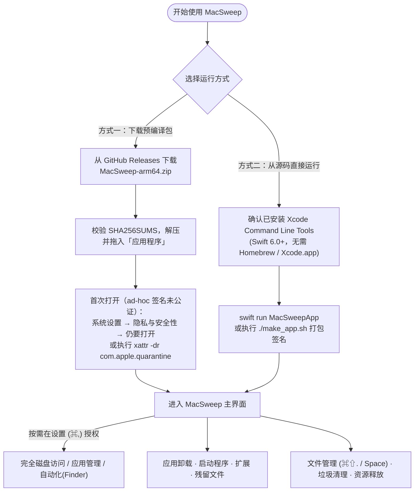

#### 1. 环境要求
- **操作系统**：**macOS 14.0 (Sonoma)** 或更高版本（支持 Apple Silicon `arm64` 与 Intel `x86_64`）。
- **源码构建工具**（仅源码编译需要）：Xcode Command Line Tools（Swift 6.0+），**无需**安装完整 `Xcode.app`，也**无需** Homebrew 依赖。

#### 2. 方式一：下载预编译包直接运行（Apple Silicon `arm64`）
每次推送 `main` 分支，CI 都会自动运行校验并发布经过完整性验证的 Preview Release：

```bash
# 使用 GitHub CLI 下载最新预编译包与校验文件（也可直接在网页端 Releases 页面下载）
TAG=$(gh release list --repo ChingYung717/MacSweep -L 1 --json tagName -q '.[0].tagName')
gh release download "$TAG" --repo ChingYung717/MacSweep --pattern 'MacSweep-arm64.zip' --pattern 'SHA256SUMS' --pattern 'build-info.txt'
shasum -a 256 --check SHA256SUMS

# 解压并移入 /Applications
unzip -q MacSweep-arm64.zip
mv MacSweep.app /Applications/
```

> **首次打开提示**：CI 发布的预编译预览包采用 ad-hoc 签名且未公证（`Signature: ad hoc, not notarized`）。首次启动若遇到 macOS Gatekeeper 拦截，可在「**系统设置 → 隐私与安全性**」底部点击「**仍要打开**」，或在终端执行以下命令移除隔离属性后启动：
> ```bash
> xattr -dr com.apple.quarantine /Applications/MacSweep.app
> open /Applications/MacSweep.app
> ```

#### 3. 方式二：从源码构建、测试、演示预览与打包

```bash
# 运行核心引擎沙盒与回归校验（148 项）
swift run MacSweepChecks

# 执行只读本机扫描巡检（不修改任何文件）
swift run MacSweepChecks --live-audit

# 运行完整端到端验证套件（154 项严格 E2E 校验）
./Tests/MacSweepE2E/run_e2e.sh --strict --tier all

# 直接从源码启动图形界面
swift run MacSweepApp

# 以脱敏演示模式启动（使用 /Users/alex 虚构数据与合成图标，不读写本机真实数据）
swift run MacSweepApp --demo-mode --demo-tab fileManager --demo-lang en --demo-theme deepOcean

# 离屏自动导出全部 2x Retina 脱敏截图到 docs/screenshots/
swift run MacSweepApp --demo-mode --export-screenshots docs/screenshots

# 编译 Release 版本并打包签名 dist/MacSweep.app 与 dist/MacSweep-<架构>.zip
./make_app.sh
open dist/MacSweep.app
```

- **代码签名与 TCC 授权稳定性**：本地运行 `./make_app.sh` 时，脚本会自动检测钥匙串中的 `Apple Development` 证书进行签名（保证「完全磁盘访问 / 应用管理」等 TCC 授权跨重编不失效），无证书时自动降级为 ad-hoc（`-`）。也可以通过环境变量显式指定：
  - `MACSWEEP_SIGN_IDENTITY="Developer ID Application: ..."`：指定正式签名身份（自动附加 `--options runtime --timestamp`）；
  - `MACSWEEP_NOTARY_PROFILE="<keychain-profile>"`：执行公证并装订（staple）；
  - `MACSWEEP_SIGN_IDENTITY="-" ./make_app.sh`：强制使用 ad-hoc 签名（CI 默认）。

#### 4. 快捷键、系统权限与本地配置
- **快捷键**：`⌘,` 打开设置（含「保护名单」`protectedPaths` 管理）；`⌘⇧.` 在文件浏览器中切换隐藏文件显示；`Space` 触发原生 QuickLook 预览。
- **完全磁盘访问（Full Disk Access）**：非侵入式只读探测，仅在扫描受 TCC 保护的浏览器扩展/缓存目录（如 Chrome / Edge / Brave）及部分沙盒容器数据时需要。
- **应用管理（App Management）**：在 macOS 13+ 上用于允许移除 `/Applications` 下的部分第三方应用包。
- **自动化 → Finder**：移至废纸篓处理 root/受限项时用于保留「放回原处」；拒绝授权时自动降级为单次管理员提权移入 `~/.Trash`。
- **本地数据存储**：偏好设置与清理历史仅保存在 `~/Library/Application Support/MacSweep/`（`preferences.json`、`history.json`），无任何外连或遥测行为。

---

## English Documentation

**MacSweep** is a native macOS application uninstaller, startup manager, extension inspector, leftover cleaner, file manager, junk cleaner, and resource release suite written in pure **Swift 6, SwiftUI, and AppKit** via SwiftPM. It has **zero third-party runtime dependencies**, **zero background daemons**, and **zero telemetry**, and builds cleanly using standalone Xcode Command Line Tools without requiring a full `Xcode.app` installation.

### Key Highlights (7 Functional Tabs)

1. **Applications (Uninstall, Reset, Batch Removal & Drag-and-Drop)**
   - **In-Memory `LibraryIndex` + Lazy `pkgutil` Enrichment**: Scans user and system `Library` locations in a single pass and enriches selected apps with installer receipt matches across Caches, Preferences, Application Support, Containers, Group Containers, Saved Application State, HTTPStorages, WebKit, Cookies, Logs, LaunchAgents/Daemons, and PrivilegedHelperTools.
   - **Progressive Bounded Size Calculation**: Computes bundle and service file sizes asynchronously (`DirectorySizer`), supports collapsible size buckets, sorting (Size / Name / Last Used / Modified), live filtering, and batch uninstallation.
   - **Uninstall & Reset Modes**: Completely uninstall an app and its associated files, or switch to **Reset** mode to clear only app data and flush `cfprefsd` cache (`defaults delete <bundleID>`).
   - **Smart Safety Details**: Detects multiple installed copies sharing a bundle ID, excludes generic runtime executables and ambiguous names, supports dragging any `.app` onto the window or Dock icon, and terminates running apps gracefully without silent force-quitting.

2. **Startup Programs (LaunchAgents, LaunchDaemons & Login Items)**
   - Unified view of `~/Library/LaunchAgents`, `/Library/LaunchAgents`, `/Library/LaunchDaemons`, and embedded app Login Items (with a shortcut to System Settings).
   - Merges `launchctl print-disabled` overrides with plist `Disabled` keys; includes XML/binary plist inspection, one-click enable/disable, orphaned binary detection, and verified `launchctl bootout` before removal.

3. **Extensions (Browser Extensions, `.appex` & System Plugins)**
   - Inspects Chrome, Microsoft Edge, Brave, Arc (`manifest.json` + `__MSG_*__` i18n), Firefox (`extensions.json`), Safari, third-party `.appex` extensions (`pluginkit -m -v`), Preference Panes, QuickLook, Spotlight, Screen Savers, Internet & Audio (HAL) plugins.
   - Protects host app code signatures by keeping embedded `.appex` toggle-only, warns before removing extensions from a running browser, and gracefully degrades when Full Disk Access is absent.

4. **Leftover Files (Orphaned Data Scanner)**
   - Builds an installed-application fingerprint inventory while automatically protecting macOS-bundled `launchd` services, Apple system components, developer toolchains/CLI directories, and shared vendor folders.
   - Separates findings into **High Confidence** (pre-checked) and **Review** (unchecked by default, including system-scope entries and shared vendor SDKs), with permanent per-group ignore support.

5. **File Manager (Space Analyzer + General File Browser)**
   - **Space Analyzer (`DiskSpaceAnalyzer`)**: Volume capacity bar, proportional folder breakdown, breadcrumb drill-down, and large/stale file filters (`≥ 50 MB`–`1 GB`, `> 90/180/365` days), strictly skipping symlinks, enforcing `st_dev` single-volume boundaries, deduplicating hardlinks by `(st_dev, st_ino)`, and skipping `SF_DATALESS` cloud placeholders.
   - **General File Browser (`FileBrowserService` + `FileOperationsEngine`)**: Favorites sidebar, Back/Forward/Up navigation, hidden files toggle (`⌘⇧.`), sorting/search, native QuickLook (`Space`) + bounded `SafeFileReader` inspector, and `SafetyGuard` + TOCTOU directory-FD validated Move, Rename, Create Folder, and Trash-first deletion.

6. **Junk & Cache Cleaner (`JunkCacheScanner`)**
   - Organizes cleanup into 5 categories: **User & App Caches** (enforcing `SafetyGuard.validateCacheSubpath` to exclude Apple caches and bare shared vendor roots like `Google`/`Adobe`/`Microsoft`/`JetBrains`), **Logs & Crash Reports**, **Browser Caches** (cache subpaths only + running-browser guard), **Developer Caches** (Xcode DerivedData/Simulators, Homebrew, npm, pnpm, pip, cargo; `Archives` unchecked by default), and **Trash Contents**.

7. **Resource Release (Large Files, 3-Stage Duplicates & Live RAM Monitor)**
   - **Large Files Finder**: Configurable threshold (`≥ 50 MB`–`1 GB`), age, type, and search filters with right-hand inspector and Skip List protection.
   - **3-Stage Duplicate Finder**: Size grouping (ignoring 0-byte, symlinks, `SF_DATALESS`, and hardlinks) → partial head/tail hashing → streaming `CryptoKit.SHA256` verification, with Smart Select presets and an all-copies deletion safeguard.
   - **Live Memory Monitor & Honest Release (`MemoryReleaseService`)**: Real-time Mach `host_statistics64` + `vm.swapusage` breakdown and pressure badge, offering non-privileged pressure relief and optional elevated `/usr/sbin/purge` with honest before/after deltas.

8. **Safety-First Architecture, Skip List & Native UX**
   - **Trash-First & `SafetyGuard`**: Defaults to moving items to Trash (preserving Put Back); `Settings → Skip List` lets you manage `protectedPaths`, `protectedBundleIDs`, and ignored leftovers.
   - **Themes & Bilingual UI**: Deep Ocean Dark (default) or Follow System Light/Dark theme, instant English / Simplified Chinese switching, and local cleanup history (up to 100 records).

### Getting Started, Build & Packaging

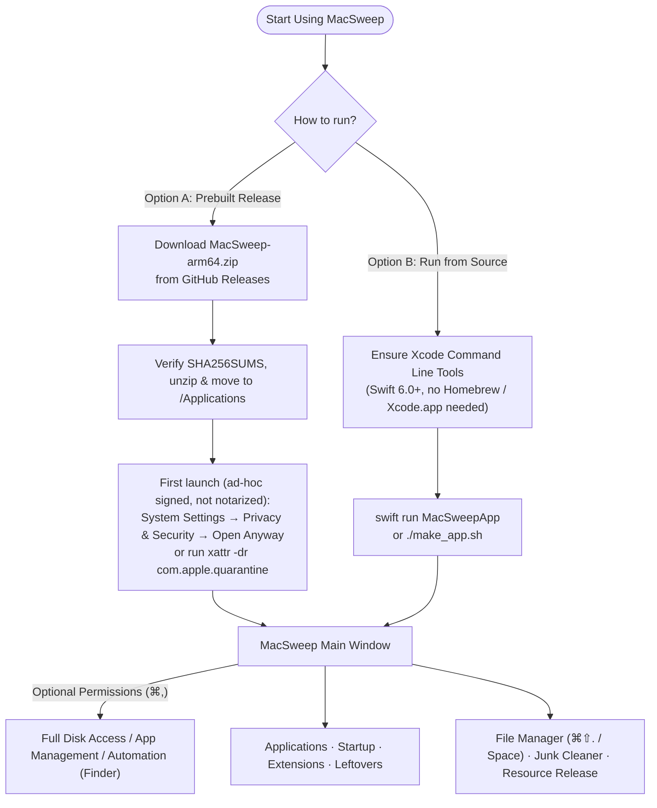

#### Option A: Download Prebuilt App Bundle (Apple Silicon `arm64`)
Every push to `main` publishes a verified preview bundle on GitHub Releases:

```bash
TAG=$(gh release list --repo ChingYung717/MacSweep -L 1 --json tagName -q '.[0].tagName')
gh release download "$TAG" --repo ChingYung717/MacSweep --pattern 'MacSweep-arm64.zip' --pattern 'SHA256SUMS' --pattern 'build-info.txt'
shasum -a 256 --check SHA256SUMS

unzip -q MacSweep-arm64.zip
mv MacSweep.app /Applications/
```

> **First-Launch Note**: Preview bundles are ad-hoc signed and not notarized (`Signature: ad hoc, not notarized`). On first launch, either click **Open Anyway** in **System Settings → Privacy & Security**, or remove the quarantine attribute:
> ```bash
> xattr -dr com.apple.quarantine /Applications/MacSweep.app
> open /Applications/MacSweep.app
> ```

#### Option B: Build, Test, Demo & Package from Source (`macOS 14.0+`)

```bash
# 1. Run all 148 sandbox & regression checks
swift run MacSweepChecks

# 2. Run a read-only live audit on this Mac (modifies nothing)
swift run MacSweepChecks --live-audit

# 3. Run the standalone E2E suite (154 strict checks)
./Tests/MacSweepE2E/run_e2e.sh --strict --tier all

# 4. Launch the GUI directly from source
swift run MacSweepApp

# 5. Launch in sanitized demo mode (/Users/alex fixtures, synthetic icons, zero host disk I/O)
swift run MacSweepApp --demo-mode --demo-tab fileManager --demo-lang en --demo-theme deepOcean

# 6. Reproduce deterministic 2x Retina screenshots into docs/screenshots/
swift run MacSweepApp --demo-mode --export-screenshots docs/screenshots

# 7. Build standalone Release bundle + zip archive
./make_app.sh
# Outputs:
#   dist/MacSweep.app
#   dist/MacSweep-<arch>.zip
open dist/MacSweep.app
```

- **Local Code Signing**: `./make_app.sh` automatically selects an `Apple Development` certificate from your keychain when available (keeping macOS TCC permissions stable across rebuilds) and falls back to ad-hoc signing (`-`) otherwise. Set `MACSWEEP_SIGN_IDENTITY` and `MACSWEEP_NOTARY_PROFILE` for Developer ID signing and notarization.
- **Shortcuts**: `⌘,` opens Settings (incl. Skip List `protectedPaths`), `⌘⇧.` toggles hidden files in File Browser, and `Space` opens QuickLook preview.

---

## 开源协议与文档 / License & Documentation

- **开源协议 / License**：本项目源代码采用 **[MIT License](./LICENSE)** 开源，零第三方运行时依赖。
- **详细文档 / Docs**：[简体中文文档 (README_ZH.md)](./README_ZH.md) · [English Documentation (README_EN.md)](./README_EN.md) · [Planning & Roadmap (docs/PLANNING.md)](./docs/PLANNING.md)
- **贡献与安全 / Contributing & Security**：请参阅 **[CONTRIBUTING.md](./CONTRIBUTING.md)** 与 **[SECURITY.md](./SECURITY.md)**。
