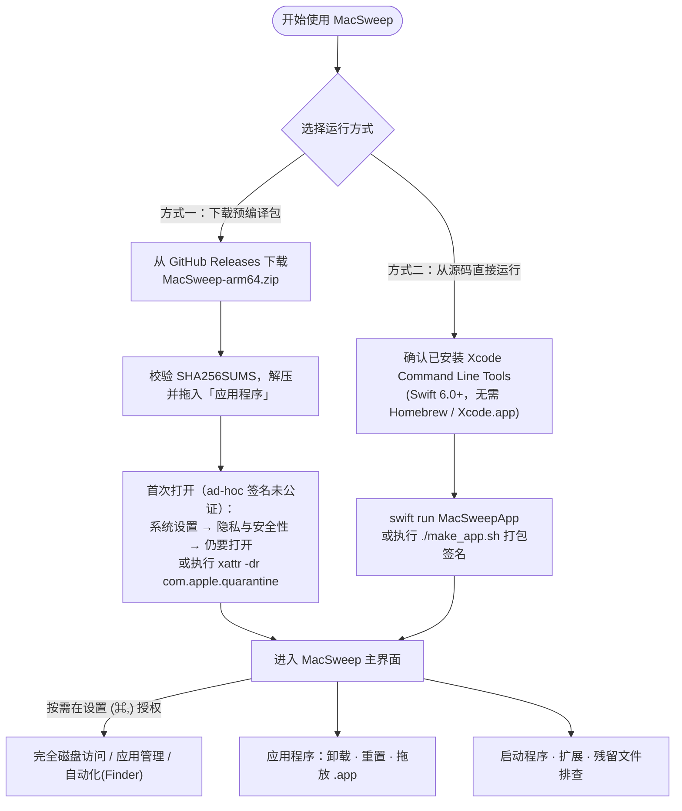
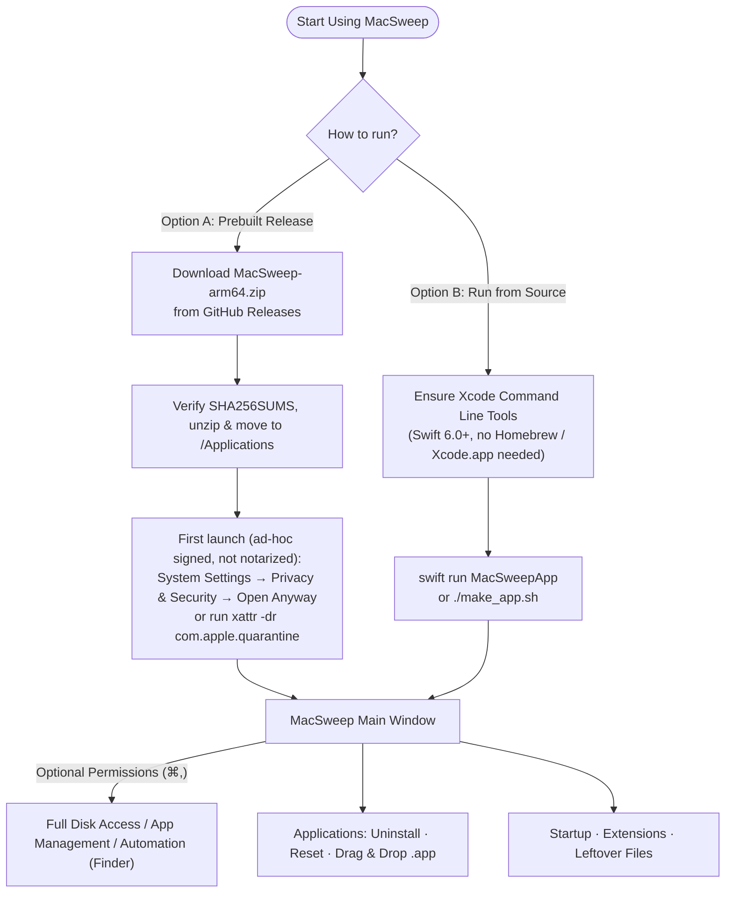

# MacSweep

<p align="center">
  
</p>

<p align="center">
  <strong>Native macOS Application Uninstaller, Startup & Extension Manager, and Leftover Cleaner built with pure Swift, SwiftUI & AppKit</strong><br>
  <strong>基于纯 Swift、SwiftUI 与 AppKit 构建的原生 macOS 应用卸载、启动项管理、扩展清理与残留扫描工具</strong>
</p>

<p align="center">
  <a href="#english-documentation">English</a> ·
  <a href="#简体中文文档">简体中文</a> ·
  <a href="./README_EN.md">README_EN.md</a> ·
  <a href="./README_ZH.md">README_ZH.md</a> ·
  <a href="./LICENSE">MIT License</a> ·
  <a href="./SECURITY.md">Security Policy</a>
</p>

---

## 简体中文文档

**MacSweep** 是一款面向 macOS (Apple Silicon / Intel) 的原生应用卸载与系统清理工具。项目完全采用 **Swift 6 + SwiftUI / AppKit + SwiftPM** 构建，**零第三方运行时依赖、零后台常驻进程、零网络遥测**，从命令行工具链（Xcode Command Line Tools）即可直接编译打包，无需安装完整 Xcode.app。

### 核心特性

1. **应用程序（彻底卸载 / 重置应用 / 批量清理 / 拖放快卸）**
   - **一次性内存索引 + `pkgutil` 懒查**：启动扫描时通过 `LibraryIndex` 一次性扫描用户与系统 `Library` 目录，并结合 `pkgutil` 安装收据懒加载关联 Caches、Preferences、Application Support、Containers、Group Containers、Saved Application State、HTTPStorages、WebKit、Cookies、Logs、LaunchAgents / LaunchDaemons 与 PrivilegedHelperTools 等全部服务文件。
   - **渐进式异步体积计算**：内置限流目录测算器（`DirectorySizer`），支持按体积分组折叠、按名称/体积/最近使用/修改时间排序与实时搜索。
   - **卸载与重置双模式**：既可完整卸载应用本体与服务文件，也可切换至「重置」模式仅清空配置与缓存（并在成功后通过 `defaults delete` 刷新 `cfprefsd` 内存缓存）。
   - **安全防护细节**：自动识别共享同一 Bundle ID 的多副本应用（默认不勾选共享服务文件）、过滤通用运行时可执行文件名与跨应用重名冲突、拖放任意 `.app` 到窗口或 Dock 图标快速分析、卸载运行中应用时优先温和退出而非静默强杀。

2. **启动程序（LaunchAgents / LaunchDaemons / 登录项）**
   - 统一扫描并按作用域分组展示 `~/Library/LaunchAgents`、`/Library/LaunchAgents`、`/Library/LaunchDaemons` 及应用内嵌登录项。
   - 结合 `launchctl print-disabled` 与 plist `Disabled` 字段还原真实启停状态，支持一键启停与 XML / 二进制 plist 内容预览。
   - 自动检测可执行文件已缺失的僵尸启动项（Broken / Orphaned），移除配置文件前自动执行 `launchctl bootout` 并校验服务确实已卸载（若服务仍存活则拒绝删除对应 plist）。

3. **扩展（浏览器扩展 / 应用扩展 / 系统插件）**
   - **浏览器扩展**：覆盖 Google Chrome、Microsoft Edge、Brave、Arc（解析 `manifest.json` 及 `__MSG_*__` 本地化名称）、Firefox（解析 `extensions.json` 用户配置扩展）与 Safari。
   - **第三方应用扩展（`.appex`）**：基于 `pluginkit -m -v` 展示与开关启用/禁用，禁止单独删除宿主包内嵌 `.appex` 以防破坏代码签名，同时支持一键跳转宿主应用完整卸载。
   - **系统插件**：涵盖偏好设置面板、QuickLook、Spotlight、屏保、互联网插件与音频插件（Components / VST / VST3 / HAL，并对 HAL 虚拟音频驱动标注重启提示）。
   - **权限优雅降级**：未授予完全磁盘访问权限时自动标注受限浏览器并提供一键直达系统设置的引导；移除 Chromium 扩展前检测并提醒先退出对应浏览器。

4. **残留文件（孤立数据智能排查）**
   - 构建全机已安装应用指纹库（`InstalledAppInventory`，包含本地化 `InfoPlist.strings` 名称与 UUID 后缀匹配），并自动排除 macOS 内置 `launchd` 系统服务（如 `accountsd`）、Apple 系统组件、常见开发工具/CLI 目录（Homebrew、Xcode、Docker、Cargo、Node、Python 等）及共享厂商父目录。
   - 按 **高置信度（默认勾选）** 与 **建议核对（默认不勾选，含系统级目录与共享厂商 SDK）** 分级展示，支持单组永久忽略。

5. **安全架构与原生体验**
   - **废纸篓优先**：默认移至废纸篓；遇到 root 或受限项目时优先委托 Finder `delete`（完整保留 macOS「放回原处」功能），若用户拒绝 Finder 自动化授权则自动降级为单次管理员提权的批量 `mv` + `chown -R -P` 移入 `~/.Trash`。
   - **双重路径与符号链接防逃逸（`SafetyGuard`）**：每次移除前对原始路径与解析后路径双重校验，拦截根目录、系统卷、SIP 受保护文件（`SF_RESTRICTED` / `SF_IMMUTABLE`）、MacSweep 自身及用户保护名单；删除符号链接时仅移除链接本身，绝不误删链接目标。
   - **原生视觉与双语**：内置「深海蓝暗色（默认）」与「跟随系统浅/深色」主题、简体中文 / English 即时切换、清理历史记录（最多保留 100 条并支持展开精确路径）。

### 系统架构图

```text
┌─────────────────────────────────────────────────────────────────────────┐
│  Sources/MacSweepApp      原生 SwiftUI 桌面端 (macOS 14+, 4 大功能页签)  │
│  ├── Views/               Applications / Startup / Extensions / Leftover│
│  ├── Components/          SidebarRail / DropZoneHero / ConfirmationSheet│
│  └── State/               AppState / Localization (ZH/EN) / Theme       │
├─────────────────────────────────────────────────────────────────────────┤
│  Sources/MacSweepCore     零依赖核心引擎库 (Pure Swift + Foundation)     │
│  ├── Scanners/            LibraryIndex / AppScanner / ServiceFileMatcher│
│  │                        StartupScanner / ExtensionScanner / Leftover  │
│  ├── Actions/             RemovalEngine / PrivilegedExecutor / Startup  │
│  ├── Safety/              SafetyGuard / PermissionChecker               │
│  └── Models/              AppItem / ServiceFile / Preferences / History │
├─────────────────────────────────────────────────────────────────────────┤
│  Tests/MacSweepChecks     29 项沙盒与回归校验套件 + 只读本机 --live-audit │
├─────────────────────────────────────────────────────────────────────────┤
│  macOS System Frameworks  SwiftUI / AppKit / Foundation / Darwin /      │
│                           launchctl / pluginkit / pkgutil / osascript   │
└─────────────────────────────────────────────────────────────────────────┘
```

### 快速开始与构建打包



#### 1. 环境要求
- **操作系统**：**macOS 14.0 (Sonoma)** 或更高版本（支持 Apple Silicon `arm64` 与 Intel `x86_64`）。
- **源码构建工具**（仅源码编译需要）：Xcode Command Line Tools（Swift 6.0+），**无需**安装完整 Xcode.app，也**无需** Homebrew 依赖。

#### 2. 方式一：下载预编译包直接运行（Apple Silicon `arm64`）
每次推送 `main` 分支，CI 都会自动运行校验并发布经过完整性验证的 Preview Release：

```bash
# 使用 GitHub CLI 下载最新预编译包与校验文件（也可直接在网页端 Releases 页面下载）
TAG=$(gh release list --repo ChingYung717/MacSweep -L 1 --json tagName -q '.[0].tagName')
gh release download "$TAG" --repo ChingYung717/MacSweep --pattern 'MacSweep-arm64.zip' --pattern 'SHA256SUMS' --pattern 'build-info.txt'
shasum -a 256 --check SHA256SUMS

# 解压并移入 /Applications
unzip -q MacSweep-arm64.zip
mv MacSweep.app /Applications/
```

> **首次打开提示**：CI 发布的预编译预览包采用 ad-hoc 签名且未公证（`Signature: ad hoc, not notarized`）。首次启动若遇到 macOS Gatekeeper 拦截，可在「**系统设置 → 隐私与安全性**」底部点击「**仍要打开**」，或在终端执行以下命令移除隔离属性后启动：
> ```bash
> xattr -dr com.apple.quarantine /Applications/MacSweep.app
> open /Applications/MacSweep.app
> ```

#### 3. 方式二：从源码构建、测试与打包

```bash
# 运行核心引擎沙盒与回归校验（29 项）
swift run MacSweepChecks

# 执行只读本机扫描巡检（不修改任何文件）
swift run MacSweepChecks --live-audit

# 直接从源码启动图形界面
swift run MacSweepApp

# 编译 Release 版本并打包签名 dist/MacSweep.app 与 dist/MacSweep-<架构>.zip
./make_app.sh
open dist/MacSweep.app
```

- **代码签名与 TCC 授权稳定性**：本地运行 `./make_app.sh` 时，脚本会自动检测钥匙串中的 `Apple Development` 证书进行签名（保证「完全磁盘访问 / 应用管理」等 TCC 授权跨重编不失效），无证书时自动降级为 ad-hoc（`-`）。也可以通过环境变量显式指定：
  - `MACSWEEP_SIGN_IDENTITY="Developer ID Application: ..."`：指定正式签名身份（自动附加 `--options runtime --timestamp`）；
  - `MACSWEEP_NOTARY_PROFILE="<keychain-profile>"`：执行公证并装订（staple）；
  - `MACSWEEP_SIGN_IDENTITY="-" ./make_app.sh`：强制使用 ad-hoc 签名（CI 默认）。
- **预览包与正式发布说明**：`main` 分支 CI 自动发布的 `v<版本>-<短SHA>`（如 `v1.0.0-abc1234`）预发布标签产物属于面向测试验证的预览构建（ad-hoc 签名、未公证，附带 `SHA256SUMS` 与记录构建环境的 `build-info.txt`）。

#### 4. 系统权限与本地配置
- **完全磁盘访问（Full Disk Access）**：非侵入式只读探测，仅在扫描受 TCC 保护的浏览器扩展目录（如 Chrome / Edge / Brave / Safari）及部分沙盒容器数据时需要。
- **应用管理（App Management）**：在 macOS 13+ 上用于允许移除 `/Applications` 下的部分第三方应用包。
- **自动化 → Finder**：移至废纸篓处理 root/受限项时用于保留「放回原处」；拒绝授权时自动降级为单次管理员提权移入 `~/.Trash`。
- **本地数据存储**：偏好设置与清理历史仅保存在 `~/Library/Application Support/MacSweep/`（`preferences.json`、`history.json`），无任何外连或遥测行为。

---

## English Documentation

**MacSweep** is a native macOS application uninstaller, startup manager, extension inspector, and leftover cleaner written in pure **Swift 6, SwiftUI, and AppKit** via SwiftPM. It has **zero third-party runtime dependencies**, **zero background daemons**, and **zero telemetry**, and builds cleanly using standalone Xcode Command Line Tools without requiring a full `Xcode.app` installation.

### Key Highlights

1. **Applications (Uninstall, Reset, Batch Removal & Drag-and-Drop)**
   - **In-Memory `LibraryIndex` + Lazy `pkgutil` Enrichment**: Scans user and system `Library` locations in a single pass and enriches selected apps with installer receipt matches across Caches, Preferences, Application Support, Containers, Group Containers, Saved Application State, HTTPStorages, WebKit, Cookies, Logs, LaunchAgents/Daemons, and PrivilegedHelperTools.
   - **Progressive Bounded Size Calculation**: Computes bundle and service file sizes asynchronously (`DirectorySizer`), supports collapsible size buckets, sorting (Size / Name / Last Used / Modified), live filtering, and batch uninstallation.
   - **Uninstall & Reset Modes**: Completely uninstall an app and its associated files, or switch to **Reset** mode to clear only app data and flush `cfprefsd` cache (`defaults delete <bundleID>`).
   - **Smart Safety Details**: Detects multiple installed copies sharing a bundle ID (leaves shared service files unchecked by default), excludes generic runtime executables and ambiguous names shared across apps, supports dragging any `.app` onto the window or Dock icon, and terminates running apps gracefully without silent force-quitting.

2. **Startup Programs (LaunchAgents, LaunchDaemons & Login Items)**
   - Unified view of `~/Library/LaunchAgents`, `/Library/LaunchAgents`, `/Library/LaunchDaemons`, and embedded app Login Items (with a shortcut to System Settings).
   - Merges `launchctl print-disabled` overrides with plist `Disabled` keys to reflect true runtime state; includes XML/binary plist inspection and one-click enable/disable.
   - Flags orphaned startup entries whose target binary is missing and enforces `launchctl bootout` + verification before deleting any launch plist (refusing deletion if the job remains loaded).

3. **Extensions (Browser Extensions, `.appex` & System Plugins)**
   - **Browsers**: Inspects Chrome, Microsoft Edge, Brave, Arc (`manifest.json` + `__MSG_*__` localization), Firefox (`extensions.json`), and Safari extensions.
   - **App Extensions (`.appex`)**: Lists and toggles third-party extensions via `pluginkit -m -v` without breaking the host app's code signature, with one-click navigation to inspect the host app.
   - **System Plugins**: Covers Preference Panes, QuickLook, Spotlight, Screen Savers, Internet Plug-Ins, and Audio Plug-Ins (Components / VST / VST3 / HAL with reboot reminder).
   - **Graceful Permission Degradation**: Clearly lists TCC-restricted browsers when Full Disk Access is absent and warns before removing extensions of a running Chromium browser.

4. **Leftover Files (Orphaned Data Scanner)**
   - Builds an installed-application fingerprint inventory (including localized `InfoPlist.strings` names and UUID-suffixed directories) while automatically protecting macOS-bundled `launchd` services, Apple system components, developer toolchains/CLI directories, and shared vendor folders.
   - Separates findings into **High Confidence** (pre-checked) and **Review** (unchecked by default, including system-scope entries and shared vendor SDKs), with permanent per-group ignore support.

5. **Safety-First Architecture & Native UX**
   - **Trash-First & Put Back**: Defaults to moving items to Trash; delegates root/protected items to Finder `delete` first (preserving macOS **Put Back**), falling back to a single-prompt privileged `mv` + `chown -R -P` into `~/.Trash` if Finder Automation is declined.
   - **Dual-Path & Symlink Protection (`SafetyGuard`)**: Validates both raw and symlink-resolved paths against critical directories, immutable system prefixes, SIP flags (`SF_RESTRICTED` / `SF_IMMUTABLE`), MacSweep itself, and user skip lists; removing a symlink deletes only the link and never follows it to its target.
   - **Themes & Bilingual UI**: Deep Ocean Dark (default) or Follow System Light/Dark theme, instant English / Simplified Chinese switching, and local cleanup history (up to 100 records with expandable removed paths).

### Getting Started, Build & Packaging



#### Option A: Download Prebuilt App Bundle (Apple Silicon `arm64`)
Every push to `main` publishes a verified preview bundle on GitHub Releases:

```bash
TAG=$(gh release list --repo ChingYung717/MacSweep -L 1 --json tagName -q '.[0].tagName')
gh release download "$TAG" --repo ChingYung717/MacSweep --pattern 'MacSweep-arm64.zip' --pattern 'SHA256SUMS' --pattern 'build-info.txt'
shasum -a 256 --check SHA256SUMS

unzip -q MacSweep-arm64.zip
mv MacSweep.app /Applications/
```

> **First-Launch Note**: Preview bundles are ad-hoc signed and not notarized (`Signature: ad hoc, not notarized`). On first launch, either click **Open Anyway** in **System Settings → Privacy & Security**, or remove the quarantine attribute:
> ```bash
> xattr -dr com.apple.quarantine /Applications/MacSweep.app
> open /Applications/MacSweep.app
> ```

#### Option B: Build, Test & Package from Source (`macOS 14.0+`)

```bash
# 1. Run all 29 sandbox & regression checks
swift run MacSweepChecks

# 2. Run a read-only live audit on this Mac (modifies nothing)
swift run MacSweepChecks --live-audit

# 3. Launch the GUI directly from source
swift run MacSweepApp

# 4. Build standalone Release bundle + zip archive
./make_app.sh
# Outputs:
#   dist/MacSweep.app
#   dist/MacSweep-<arch>.zip
open dist/MacSweep.app
```

- **Local Code Signing**: `./make_app.sh` automatically selects an `Apple Development` certificate from your keychain when available (keeping macOS TCC permissions stable across rebuilds) and falls back to ad-hoc signing (`-`) otherwise. Set `MACSWEEP_SIGN_IDENTITY` and `MACSWEEP_NOTARY_PROFILE` for Developer ID signing and notarization.
- **Preview vs. Formal Releases**: `v<version>-<shortSHA>` prerelease tags published from `main` are ad-hoc signed, unnotarized preview builds accompanied by `SHA256SUMS` and `build-info.txt`.

---

## 开源协议与文档 / License & Documentation

- **开源协议 / License**：本项目源代码采用 **[MIT License](./LICENSE)** 开源，零第三方运行时依赖。
- **详细文档 / Docs**：[简体中文文档 (README_ZH.md)](./README_ZH.md) · [English Documentation (README_EN.md)](./README_EN.md)
- **贡献与安全 / Contributing & Security**：请参阅 **[CONTRIBUTING.md](./CONTRIBUTING.md)** 与 **[SECURITY.md](./SECURITY.md)**。
