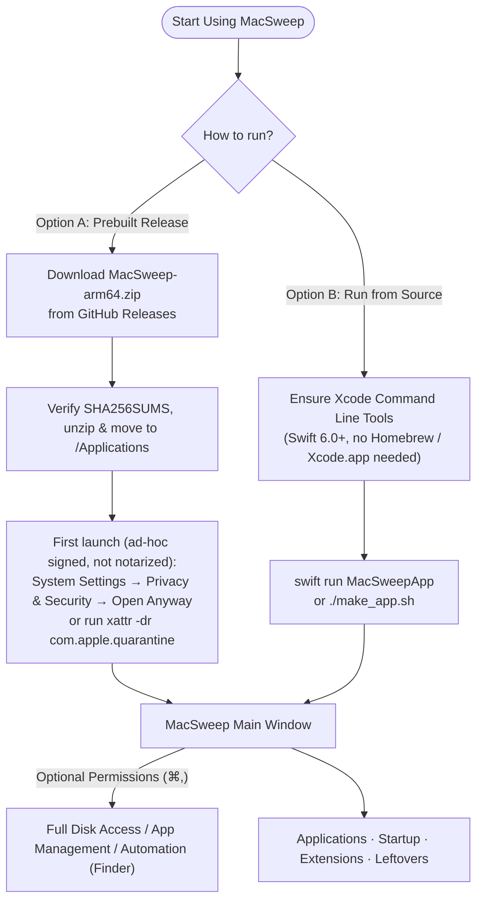

# MacSweep (English Documentation)

<p align="left">
  <a href="./README.md">Bilingual Main README</a> ·
  <a href="./README_ZH.md">简体中文文档 (README_ZH.md)</a> ·
  <a href="./LICENSE">MIT License</a> ·
  <a href="./SECURITY.md">Security Policy</a>
</p>

**MacSweep** is a native macOS (14.0+) application uninstaller, startup manager, extension inspector, and leftover cleaner built with pure **Swift 6, SwiftUI, and AppKit** via SwiftPM. It has zero third-party runtime dependencies, zero background daemons, and zero network telemetry.

---

## 1. Architecture

```text
MacSweep/
├── Package.swift                       # SwiftPM manifest (macOS 14+, Swift 6.0, zero external deps)
├── Resources/
│   └── AppIcon-1024.png                # Deep Ocean icon artwork (compiled into AppIcon.icns on build)
├── Sources/
│   ├── MacSweepCore/                   # Pure Swift core engine library
│   │   ├── Models/                     # AppItem, ServiceFile, StartupItem, ExtensionItem, LeftoverItem, Preferences, CleanupRecord
│   │   ├── Scanners/                   # LibraryIndex, AppScanner, ServiceFileMatcher, DirectorySizer, StartupScanner, ExtensionScanner, LeftoverScanner
│   │   ├── Actions/                    # RemovalEngine, PrivilegedExecutor, StartupController, ProcessRunner
│   │   └── Safety/                     # SafetyGuard, PermissionChecker
│   └── MacSweepApp/                    # Native SwiftUI macOS application
│       ├── MacSweepApp.swift           # App entry point, Dock drop handling, menu shortcuts
│       ├── State/                      # AppState, Localization (ZH/EN), Theme
│       ├── Views/                      # ApplicationsView, StartupProgramsView, ExtensionsView, LeftoversView, MainSplitView, SettingsSheet
│       └── Components/                 # SidebarRail, DropZoneHeroView, ConfirmationSheet, FileRowView, AppIconView
├── Tests/
│   └── MacSweepChecks/                 # 29 sandbox & regression checks (+ read-only --live-audit)
├── scripts/
│   ├── generate_icon.swift             # Programmatic squircle icon generator
│   └── publish_preview.sh              # GitHub Releases preview publisher & verifier
└── make_app.sh                         # Standalone .app bundler, auto-versioning, signing & zip archiver
```

---

## 2. Capabilities

| Module | Capabilities | Safety & Boundaries |
|---|---|---|
| **Applications** | Single-pass `LibraryIndex` + lazy `pkgutil` receipt matching; progressive bounded size calculation; collapsible size buckets & sorting; Uninstall vs. Reset mode (flushing `cfprefsd`); batch removal; drag-and-drop `.app` inspection onto window or Dock | Hides/locks SIP & `/System`-protected apps; leaves shared service files unchecked when duplicate copies share a bundle ID; skips generic runtimes (`Electron`) and ambiguous shared names; gracefully quits running apps without silent force-quit |
| **Startup Programs** | Scans `~/Library/LaunchAgents`, `/Library/LaunchAgents`, `/Library/LaunchDaemons`, and embedded app Login Items; merges `launchctl print-disabled` overrides; one-click enable/disable; XML/binary plist viewer; broken/orphaned binary detector | Rejects `com.apple.*` labels and embedded login items in `launchctl`; runs `launchctl bootout` + retry verification before deleting launch plists and keeps any plist whose service remains loaded |
| **Extensions** | Chrome, Edge, Brave, Arc (`manifest.json` + `__MSG_*__` i18n), Firefox (`extensions.json`), Safari; third-party `.appex` extensions via `pluginkit -m -v`; Preference Panes, QuickLook, Spotlight, Screen Savers, Internet & Audio (HAL) plugins | Embedded `.appex` bundles are toggle-only to preserve host app code signatures (with jump-to-host-app link); graceful degradation when Full Disk Access is absent; warns before removing running Chromium browser extensions; reboot notice for HAL drivers |
| **Leftover Files** | Builds an installed-app fingerprint inventory (including localized `InfoPlist.strings` names & UUID suffixes); classifies orphans into **High Confidence** and **Review** tiers; permanent ignore list | Excludes macOS-bundled `launchd` services, Apple system data, developer toolchains/CLI directories, and shared vendor folders; caps system-scope leftovers and shared vendor SDKs at **Review** (unchecked by default) |

---

## 3. Getting Started, Building & Packaging



### Prerequisites
- **macOS 14.0 (Sonoma)** or later (Apple Silicon `arm64` or Intel `x86_64`)
- **For building from source**: Xcode Command Line Tools (`xcode-select --install`, Swift 6.0+). No Homebrew packages or full `Xcode.app` required.

### Option A: Download Prebuilt App Bundle (Apple Silicon `arm64`)

```bash
TAG=$(gh release list --repo ChingYung717/MacSweep -L 1 --json tagName -q '.[0].tagName')
gh release download "$TAG" --repo ChingYung717/MacSweep --pattern 'MacSweep-arm64.zip' --pattern 'SHA256SUMS' --pattern 'build-info.txt'
shasum -a 256 --check SHA256SUMS

unzip -q MacSweep-arm64.zip
mv MacSweep.app /Applications/
```

> **First-Launch Note**: Preview bundles are ad-hoc signed and not notarized (`Signature: ad hoc, not notarized`). On first launch, either click **Open Anyway** in **System Settings → Privacy & Security**, or remove the quarantine attribute:
> ```bash
> xattr -dr com.apple.quarantine /Applications/MacSweep.app
> open /Applications/MacSweep.app
> ```

### Option B: Build, Test & Launch from Source

```bash
# Run all 29 sandbox & regression checks
swift run MacSweepChecks

# Run a read-only audit on the current Mac
swift run MacSweepChecks --live-audit

# Launch the desktop UI directly
swift run MacSweepApp
```

### Build Standalone `MacSweep.app`

```bash
./make_app.sh
```

`make_app.sh` builds the Release executable, compiles `AppIcon.icns` from `Resources/AppIcon-1024.png` (or regenerates the artwork if `scripts/generate_icon.swift` changed), bundles `LICENSE` and `Info.plist` with auto-incremented patch versioning, signs with an available local `Apple Development` identity (falling back to `-` ad-hoc), and creates `dist/MacSweep-<arch>.zip`. For formal signed and notarized releases, set `MACSWEEP_SIGN_IDENTITY` (Developer ID Application) and `MACSWEEP_NOTARY_PROFILE`.

---

## 4. Shortcuts & Local Data

- **Shortcuts**: `⌘,` opens Settings (General & Appearance, Permissions, Skip List, Cleanup History).
- **Local Storage**: `~/Library/Application Support/MacSweep/` stores `preferences.json` and `history.json` (up to 100 recent records with exact removed paths). No data ever leaves your Mac.

---

## 5. License & Security

MacSweep is released under the **[MIT License](./LICENSE)**. See **[SECURITY.md](./SECURITY.md)** for safety invariants and vulnerability reporting, and **[CONTRIBUTING.md](./CONTRIBUTING.md)** for contributor guidelines.
