# MacSweep (English Documentation)

<p align="left">
  <a href="./README.md">Bilingual Main README</a> ·
  <a href="./README_ZH.md">简体中文文档 (README_ZH.md)</a> ·
  <a href="./docs/PLANNING.md">Planning &amp; Roadmap</a> ·
  <a href="./LICENSE">MIT License</a> ·
  <a href="./SECURITY.md">Security Policy</a>
</p>

**MacSweep** is a native macOS (14.0+) application uninstaller, startup manager, extension inspector, leftover cleaner, file manager, junk cleaner, and resource release suite built with pure **Swift 6, SwiftUI, and AppKit** via SwiftPM. It has zero third-party runtime dependencies, zero background daemons, and zero network telemetry.

---

## 1. Architecture

```text
MacSweep/
├── Package.swift                       # SwiftPM manifest (macOS 14+, Swift 6.0, zero external deps)
├── Resources/
│   └── AppIcon-1024.png                # Deep Ocean icon artwork (compiled into AppIcon.icns on build)
├── docs/
│   ├── PLANNING.md                     # Evolution architecture, safety invariants & M1–M5 roadmap
│   └── screenshots/                    # 2x Retina (2240x1400) sanitized demo screenshots
├── Sources/
│   ├── MacSweepCore/                   # Pure Swift 6 Sendable core engine library (zero SwiftUI)
│   │   ├── Models/                     # AppItem, ServiceFile, StartupItem, ExtensionItem, LeftoverItem,
│   │   │                               # FileMutationModels, DiskTreeNode, FileBrowserItem, JunkAndResourceModels,
│   │   │                               # Preferences, CleanupRecord
│   │   ├── Scanners/                   # LibraryIndex, AppScanner, ServiceFileMatcher, DirectorySizer,
│   │   │                               # StartupScanner, ExtensionScanner, LeftoverScanner,
│   │   │                               # DiskSpaceAnalyzer, FileBrowserService, JunkCacheScanner,
│   │   │                               # LargeAndDuplicateScanner
│   │   ├── Actions/                    # RemovalEngine, FileOperationsEngine, MemoryReleaseService,
│   │   │                               # PrivilegedExecutor, StartupController, ProcessRunner
│   │   ├── Safety/                     # SafetyGuard, SafeFileReader, PermissionChecker
│   │   └── Demo/                       # DemoFixtureCatalog (/Users/alex sanitized fixtures)
│   ├── MacSweepAppEntry/               # Executable entry point (`MacSweepApp` target)
│   │   └── MacSweepApp.swift           # App entry point, CLI/env demo parser, Dock drop & shortcuts
│   └── MacSweepApp/                    # Native SwiftUI UI library (`MacSweepUI` target, 7 tabs)
│       ├── State/                      # AppState, FileManagerStore, CleanupCenterStore,
│       │                               # DemoScreenshotExporter, Localization (ZH/EN), Theme
│       ├── Views/                      # ApplicationsView, StartupProgramsView, ExtensionsView, LeftoversView,
│       │                               # FileManagerView, JunkCleanerView, ResourceReleaseView,
│       │                               # MainSplitView, SettingsSheet
│       └── Components/                 # SidebarRail, DropZoneHeroView, ConfirmationSheet, FileRowView,
│                                       # AppIconView, AnalyzerCapacityComponents, FileInspectorView,
│                                       # QuickLookPreviewController
├── Tests/
│   ├── MacSweepChecks/                 # 144 sandbox & regression checks (+ read-only --live-audit)
│   └── MacSweepE2E/                    # Standalone black-box E2E suite (154 strict checks)
├── scripts/
│   ├── generate_icon.swift             # Programmatic squircle icon generator
│   └── publish_preview.sh              # GitHub Releases preview publisher & verifier
└── make_app.sh                         # Standalone .app bundler, auto-versioning, signing & zip archiver
```

---

## 2. Capabilities (7 Tabs + Skip List)

| Module | Capabilities | Safety & Boundaries |
|---|---|---|
| **Applications** | Single-pass `LibraryIndex` + lazy `pkgutil` receipt matching; progressive bounded size calculation; collapsible size buckets & sorting; Uninstall vs. Reset mode (flushing `cfprefsd`); batch removal; drag-and-drop `.app` inspection onto window or Dock | Hides/locks SIP & `/System`-protected apps; leaves shared service files unchecked when duplicate copies share a bundle ID; skips generic runtimes (`Electron`) and ambiguous shared names; gracefully quits running apps without silent force-quit |
| **Startup Programs** | Scans `~/Library/LaunchAgents`, `/Library/LaunchAgents`, `/Library/LaunchDaemons`, and embedded app Login Items; merges `launchctl print-disabled` overrides; one-click enable/disable; XML/binary plist viewer; broken/orphaned binary detector | Rejects `com.apple.*` labels and embedded login items in `launchctl`; runs `launchctl bootout` + retry verification before deleting launch plists and keeps any plist whose service remains loaded |
| **Extensions** | Chrome, Edge, Brave, Arc (`manifest.json` + `__MSG_*__` i18n), Firefox (`extensions.json`), Safari; third-party `.appex` extensions via `pluginkit -m -v`; Preference Panes, QuickLook, Spotlight, Screen Savers, Internet & Audio (HAL) plugins | Embedded `.appex` bundles are toggle-only to preserve host app code signatures (with jump-to-host-app link); graceful degradation when Full Disk Access is absent; warns before removing running Chromium/Firefox extensions; reboot notice for HAL drivers |
| **Leftover Files** | Builds an installed-app fingerprint inventory (including localized `InfoPlist.strings` names & UUID suffixes); classifies orphans into **High Confidence** and **Review** tiers; permanent ignore list | Excludes macOS-bundled `launchd` services, Apple system data, developer toolchains/CLI directories, and shared vendor folders; caps system-scope leftovers and shared vendor SDKs at **Review** (unchecked by default) |
| **File Manager** | Dual-mode **Space Analyzer** (`DiskSpaceAnalyzer` volume capacity bar, proportion bars, breadcrumb drill-down, size/age filters) + **File Browser** (`FileBrowserService` favorites, history stack, `⌘⇧.` hidden files, sort/search, `Space` QuickLook + `SafeFileReader` inspector, Move/Rename/New Folder/Trash) | Skips symlinks, enforces `st_dev` single-volume boundaries, deduplicates hardlinks by `(st_dev, st_ino)`, skips `SF_DATALESS` placeholders; `FileOperationsEngine` verifies `SafetyGuard` + TOCTOU directory FDs (`renameatx_np(RENAME_EXCL)`, `mkdirat`); deletions route through `ConfirmationSheet` + `RemovalEngine` |
| **Junk & Cache Cleaner** | 5 categories: User & App Caches, Logs & Crash Reports, Browser Caches, Developer Caches (Xcode DerivedData/Simulators, Homebrew, npm, pnpm, pip, cargo), and Trash Contents | Enforces `SafetyGuard.validateCacheSubpath` to block Apple caches and bare shared vendor roots (`Google`, `Microsoft`, `Adobe`, `JetBrains`, etc.); blocks cleaning caches of running browsers; keeps system logs & Xcode Archives unchecked by default |
| **Resource Release** | **Large Files** (`≥ 50 MB`–`1 GB`, age/type filters), **3-Stage Duplicate Finder** (size → partial hash → streaming `CryptoKit.SHA256`, Smart Select keep-one), and **Live RAM Monitor & Honest Release** (`host_statistics64` + `vm.swapusage`) | Deduplicates hardlinks and ignores 0-byte/symlink/`SF_DATALESS` entries; warns before deleting all duplicate copies; prunes `.app`/`.photoslibrary`/`.ssh`/`protectedPaths`; never fakes RAM reclaimed figures (non-privileged relief vs. explicit elevated `/usr/sbin/purge`) |
| **Settings · Skip List** | Manage `protectedPaths`, `protectedBundleIDs`, ignored leftovers, themes (`Deep Ocean Dark` / `Follow System`), bilingual UI (`EN`/`ZH`), and local cleanup history | `SafetyGuard` blocks scanning, moving, renaming, or deleting any item overlapping `protectedPaths` across all 7 tabs |

---

## 3. Visual Showcase (`--demo-mode` 2x Retina)

All screenshots below are generated deterministically via `--demo-mode --export-screenshots docs/screenshots` using fictional `/Users/alex` fixtures and synthetic icons:

<table>
  <tr>
    <td align="center" width="50%">
      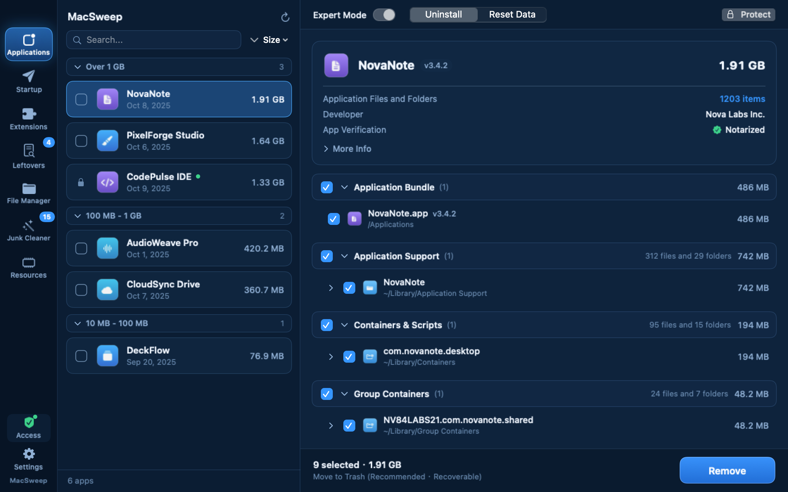<br>
      <sub><b>Applications</b> — Size buckets, service files &amp; Uninstall/Reset</sub>
    </td>
    <td align="center" width="50%">
      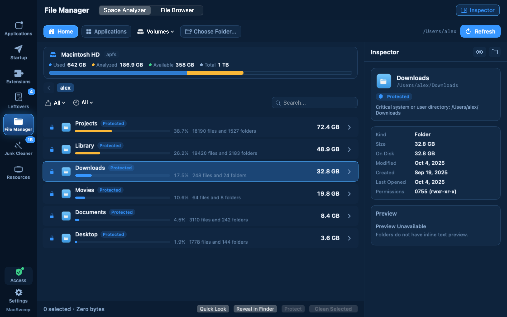<br>
      <sub><b>File Manager · Space Analyzer</b> — Volume bar &amp; directory breakdown</sub>
    </td>
  </tr>
  <tr>
    <td align="center" width="50%">
      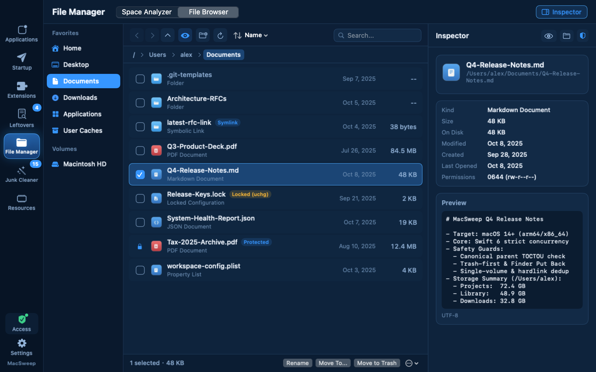<br>
      <sub><b>File Manager · File Browser</b> — Safe file ops &amp; bounded inspector</sub>
    </td>
    <td align="center" width="50%">
      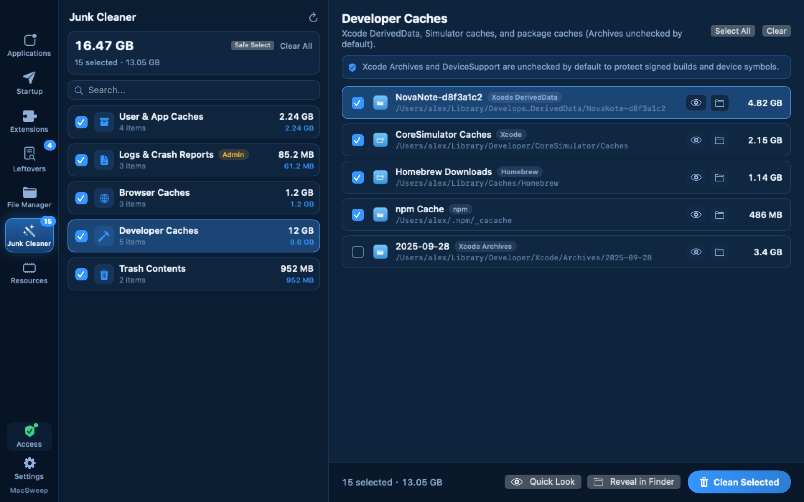<br>
      <sub><b>Junk Cleaner</b> — 5 isolated categories &amp; safety notes</sub>
    </td>
  </tr>
  <tr>
    <td align="center" width="50%">
      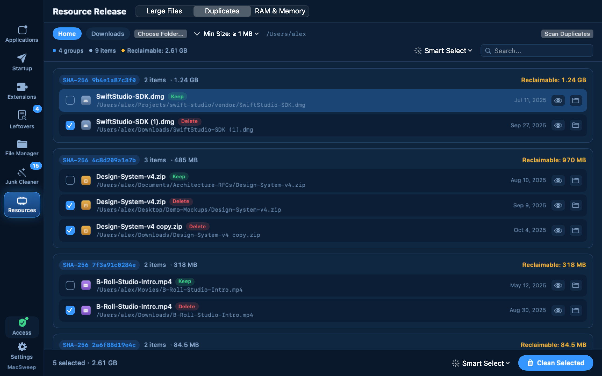<br>
      <sub><b>Resource Release · Duplicates</b> — 3-stage SHA-256 &amp; Smart Select</sub>
    </td>
    <td align="center" width="50%">
      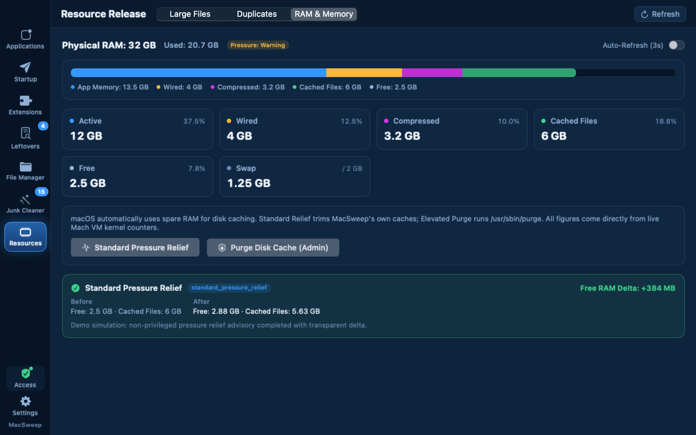<br>
      <sub><b>Resource Release · RAM</b> — Live Mach VM breakdown &amp; honest relief</sub>
    </td>
  </tr>
  <tr>
    <td align="center" width="50%">
      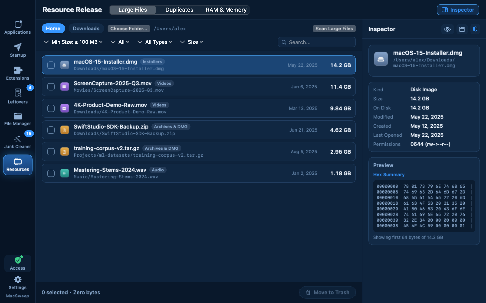<br>
      <sub><b>Resource Release · Large Files</b> — Threshold/age/type filters</sub>
    </td>
    <td align="center" width="50%">
      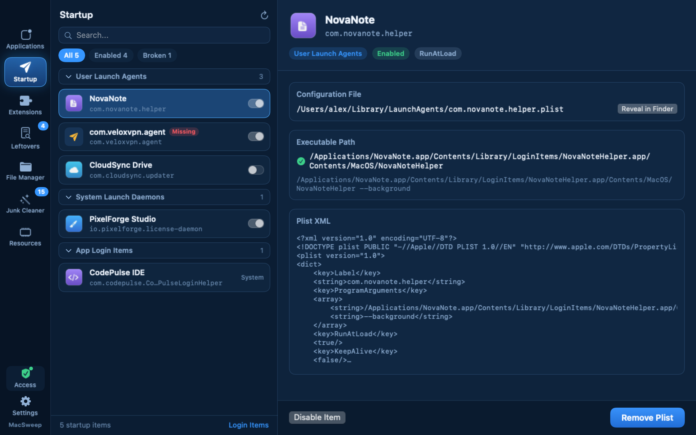<br>
      <sub><b>Startup Programs</b> — LaunchAgents/Daemons &amp; plist preview</sub>
    </td>
  </tr>
  <tr>
    <td align="center" width="50%">
      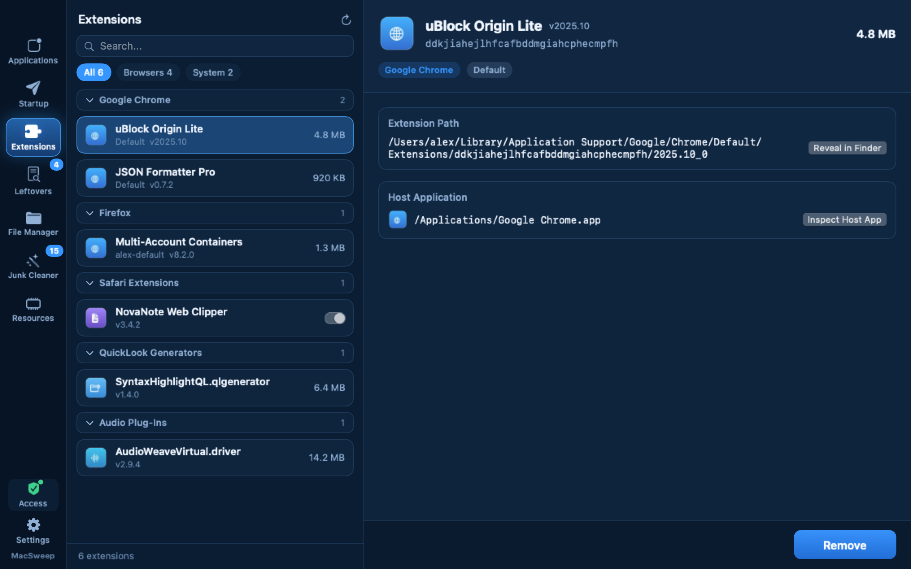<br>
      <sub><b>Extensions</b> — Browser add-ons, .appex &amp; HAL audio plugins</sub>
    </td>
    <td align="center" width="50%">
      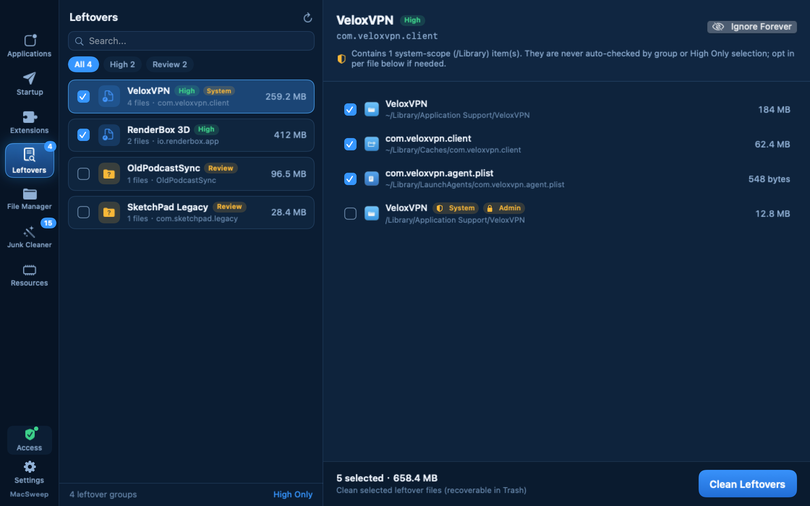<br>
      <sub><b>Leftover Files</b> — High-confidence &amp; system-scope orphans</sub>
    </td>
  </tr>
  <tr>
    <td align="center" width="50%">
      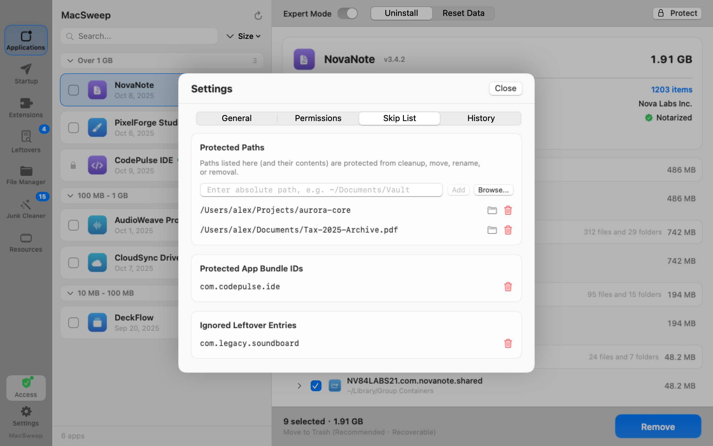<br>
      <sub><b>Settings · Skip List (Light)</b> — Protected paths in Light theme</sub>
    </td>
    <td align="center" width="50%">
      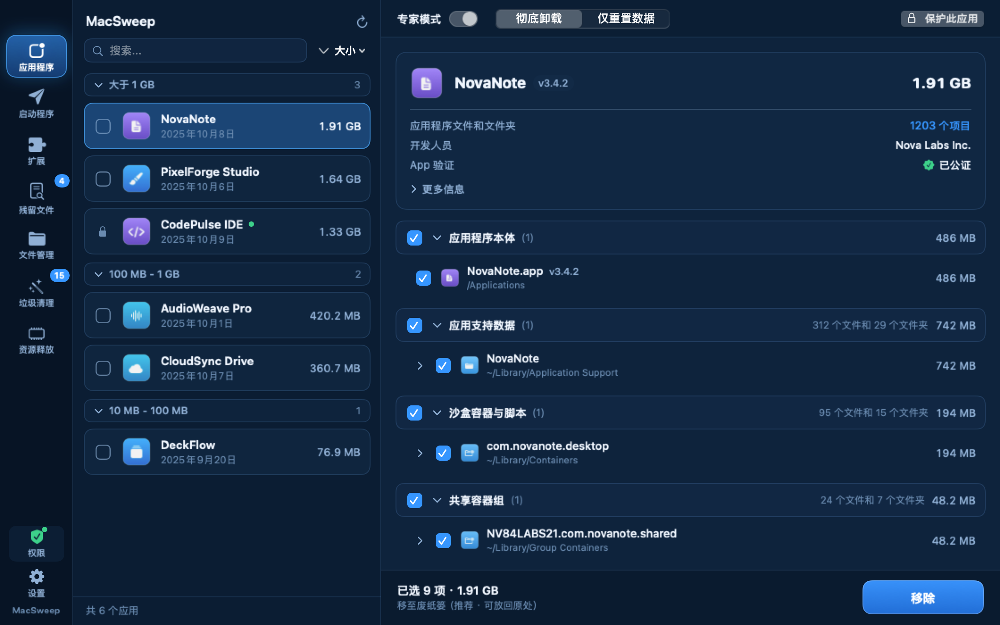<br>
      <sub><b>Bilingual UI (简体中文)</b> — Native Simplified Chinese typography</sub>
    </td>
  </tr>
</table>

---

## 4. Getting Started, Building & Packaging

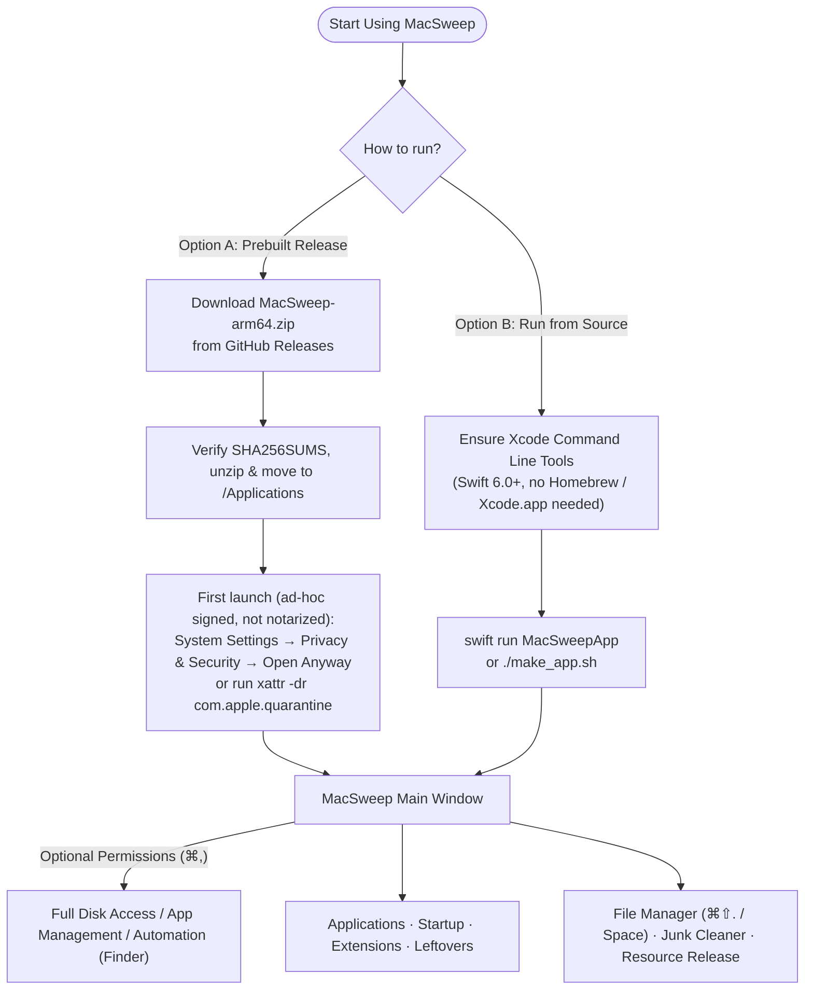

### Prerequisites
- **macOS 14.0 (Sonoma)** or later (Apple Silicon `arm64` or Intel `x86_64`)
- **For building from source**: Xcode Command Line Tools (`xcode-select --install`, Swift 6.0+). No Homebrew packages or full `Xcode.app` required.

### Option A: Download Prebuilt App Bundle (Apple Silicon `arm64`)

```bash
TAG=$(gh release list --repo ChingYung717/MacSweep -L 1 --json tagName -q '.[0].tagName')
gh release download "$TAG" --repo ChingYung717/MacSweep --pattern 'MacSweep-arm64.zip' --pattern 'SHA256SUMS' --pattern 'build-info.txt'
shasum -a 256 --check SHA256SUMS

unzip -q MacSweep-arm64.zip
mv MacSweep.app /Applications/
```

> **First-Launch Note**: Preview bundles are ad-hoc signed and not notarized (`Signature: ad hoc, not notarized`). On first launch, either click **Open Anyway** in **System Settings → Privacy & Security**, or remove the quarantine attribute:
> ```bash
> xattr -dr com.apple.quarantine /Applications/MacSweep.app
> open /Applications/MacSweep.app
> ```

### Option B: Build, Test, Demo & Launch from Source

```bash
# Run all 144 sandbox & regression checks
swift run MacSweepChecks

# Run a read-only audit on the current Mac
swift run MacSweepChecks --live-audit

# Run the standalone E2E verification suite (154 strict checks)
./Tests/MacSweepE2E/run_e2e.sh --strict --tier all

# Launch the desktop UI directly
swift run MacSweepApp

# Launch in sanitized demo mode (/Users/alex fixtures, synthetic icons, zero host disk I/O)
swift run MacSweepApp --demo-mode --demo-tab fileManager --demo-lang en --demo-theme deepOcean

# Export reproducible 2x Retina screenshots into docs/screenshots/
swift run MacSweepApp --demo-mode --export-screenshots docs/screenshots
```

### Build Standalone `MacSweep.app`

```bash
./make_app.sh
```

`make_app.sh` builds the Release executable, compiles `AppIcon.icns` from `Resources/AppIcon-1024.png` (or regenerates the artwork if `scripts/generate_icon.swift` changed), bundles `LICENSE` and `Info.plist` with auto-incremented patch versioning, signs with an available local `Apple Development` identity (falling back to `-` ad-hoc), and creates `dist/MacSweep-<arch>.zip`. For formal signed and notarized releases, set `MACSWEEP_SIGN_IDENTITY` (Developer ID Application) and `MACSWEEP_NOTARY_PROFILE`.

---

## 5. Shortcuts & Local Data

- **Shortcuts**:
  - `⌘,` opens Settings (General & Appearance, Permissions, Skip List, Cleanup History).
  - `⌘⇧.` toggles hidden files in the File Browser.
  - `Space` toggles QuickLook preview on the selected file.
- **Local Storage**: `~/Library/Application Support/MacSweep/` stores `preferences.json` and `history.json` (up to 100 recent records with exact removed paths). No data ever leaves your Mac.

---

## 6. License, Planning & Security

MacSweep is released under the **[MIT License](./LICENSE)**. See **[docs/PLANNING.md](./docs/PLANNING.md)** for the full architecture and roadmap, **[SECURITY.md](./SECURITY.md)** for safety invariants and vulnerability reporting, and **[CONTRIBUTING.md](./CONTRIBUTING.md)** for contributor guidelines.
