# MacSweep（简体中文详细文档）

<p align="left">
  <a href="./README.md">中英双语主文档 (README.md)</a> ·
  <a href="./README_EN.md">English Documentation (README_EN.md)</a> ·
  <a href="./docs/PLANNING.md">演进规划与路线图 (PLANNING.md)</a> ·
  <a href="./LICENSE">MIT 开源协议</a> ·
  <a href="./SECURITY.md">安全策略 (SECURITY.md)</a>
</p>

**MacSweep** 是面向 macOS 14+ 的原生应用卸载、文件管理、垃圾清理与资源释放工具，基于纯 **Swift 6、SwiftUI 与 AppKit** 构建，通过 SwiftPM 管理工程，零第三方运行时依赖、零后台常驻进程、零网络遥测。

---

## 1. 模块划分与工程结构

```text
MacSweep/
├── Package.swift                       # SwiftPM 包配置（macOS 14+，Swift 6.0，零外部依赖）
├── Resources/
│   └── AppIcon-1024.png                # 深海蓝应用图标源图（构建时自动生成 AppIcon.icns）
├── docs/
│   ├── PLANNING.md                     # 产品演进规划、安全边界与 M1–M5 路线图
│   └── screenshots/                    # 2x Retina (2240x1400) 脱敏演示截图
├── Sources/
│   ├── MacSweepCore/                   # 纯 Swift 6 严格并发核心引擎库（零 SwiftUI）
│   │   ├── Models/                     # AppItem / ServiceFile / StartupItem / ExtensionItem / LeftoverItem /
│   │   │                               # FileMutationModels / DiskTreeNode / FileBrowserItem /
│   │   │                               # JunkAndResourceModels / Preferences / CleanupRecord
│   │   ├── Scanners/                   # LibraryIndex / AppScanner / ServiceFileMatcher / DirectorySizer /
│   │   │                               # StartupScanner / ExtensionScanner / LeftoverScanner /
│   │   │                               # DiskSpaceAnalyzer / FileBrowserService / JunkCacheScanner /
│   │   │                               # LargeAndDuplicateScanner
│   │   ├── Actions/                    # RemovalEngine / FileOperationsEngine / MemoryReleaseService /
│   │   │                               # PrivilegedExecutor / StartupController / ProcessRunner
│   │   ├── Safety/                     # SafetyGuard / SafeFileReader / PermissionChecker
│   │   └── Demo/                       # DemoFixtureCatalog（/Users/alex 脱敏夹具）
│   ├── MacSweepAppEntry/               # 可执行入口模块（`MacSweepApp` Target）
│   │   └── MacSweepApp.swift           # 应用入口、CLI/Env 演示模式解析、Dock 拖放与快捷键
│   └── MacSweepApp/                    # 原生 macOS SwiftUI 界面库（`MacSweepUI` Target，7 大页签）
│       ├── State/                      # AppState / FileManagerStore / CleanupCenterStore /
│       │                               # DemoScreenshotExporter / Localization / Theme
│       ├── Views/                      # ApplicationsView / StartupProgramsView / ExtensionsView /
│       │                               # LeftoversView / FileManagerView / JunkCleanerView /
│       │                               # ResourceReleaseView / MainSplitView / SettingsSheet
│       └── Components/                 # SidebarRail / DropZoneHeroView / ConfirmationSheet / FileRowView /
│                                       # AppIconView / AnalyzerCapacityComponents / FileInspectorView /
│                                       # QuickLookPreviewController
├── Tests/
│   ├── MacSweepChecks/                 # 144 项沙盒与回归校验套件（含 --live-audit 只读巡检）
│   └── MacSweepE2E/                    # 独立黑盒端到端测试套件（154 项严格 E2E 校验）
├── scripts/
│   ├── generate_icon.swift             # 图标生成器
│   └── publish_preview.sh              # GitHub Releases 预览包发布与校验脚本
└── make_app.sh                         # 独立 .app 打包、自动版本递增、签名与 zip 归档脚本
```

---

## 2. 功能一览（7 大功能页签 + 保护名单）

| 功能模块 | 核心能力 | 安全与边界保护 |
|---|---|---|
| **应用程序 (`Applications`)** | 扫描已安装应用；一次性 `LibraryIndex` 索引 + `pkgutil` 懒查关联服务文件；按体积分组折叠与异步测算；支持彻底卸载、仅重置应用数据（含 `cfprefsd` 清理）、批量卸载与拖放任意 `.app` 分析 | 隐藏/只读保护受 SIP 或系统卷保护的内置应用；共享同一 Bundle ID 的多副本默认不勾选服务文件；过滤通用运行时（如 `Electron`）与跨应用重名目录；运行中应用仅温和退出，超时后由用户显式决定是否强退 |
| **启动程序 (`Startup`)** | 覆盖 `~/Library/LaunchAgents`、`/Library/LaunchAgents`、`/Library/LaunchDaemons` 与应用内嵌登录项；融合 `launchctl print-disabled` 真实状态；支持启停切换、XML/二进制 plist 预览与僵尸启动项排查 | 拒绝通过 `launchctl` 修改 `com.apple.*` 与内嵌登录项；删除启动项 plist 前先执行 `launchctl bootout` 并重试校验服务不再加载，仍存活则保留 plist |
| **扩展 (`Extensions`)** | 统一管理 Chrome / Edge / Brave / Arc / Firefox / Safari 浏览器扩展、第三方 `.appex` 应用扩展（`pluginkit`）以及偏好面板、QuickLook、Spotlight、屏保、互联网与音频插件（含 HAL） | 内嵌 `.appex` 禁止单独删除以免破坏宿主签名，支持直接开关或跳转宿主应用；未获完全磁盘访问权限时优雅降级提示；删除 Chromium / Firefox 扩展前检测对应浏览器运行状态；HAL 音频驱动附带重启提示 |
| **残留文件 (`Leftovers`)** | 构建全机已安装应用指纹库（含 `InfoPlist.strings` 本地化名称、UUID 后缀），按「高置信度 / 建议核对」分级展示孤立残留并支持永久忽略 | 自动排除 macOS 内置 `launchd` 服务、Apple 系统目录、常见开发工具/CLI 目录及共享厂商父目录；系统级目录与共享厂商 SDK 上限为「建议核对」且默认不勾选 |
| **文件管理 (`File Manager`)** | 双子模式：**空间分析**（`DiskSpaceAnalyzer` 卷容量条、体积占比条、面包屑下钻、大小/陈旧筛选）+ **文件浏览**（`FileBrowserService` 常用位置、历史栈、`⌘⇧.` 隐藏文件切换、排序搜索、`Space` QuickLook + `SafeFileReader` 限流预览、移动/重命名/新建文件夹/删除） | 跳过符号链接、遵循 `st_dev` 单卷边界、`(st_dev, st_ino)` 硬链接去重、跳过 `SF_DATALESS` 云占位；`FileOperationsEngine` 强制 `SafetyGuard` + TOCTOU 目录 FD 校验（`renameatx_np(RENAME_EXCL)`、`mkdirat`）；删除统一经 `ConfirmationSheet` + `RemovalEngine` |
| **垃圾清理 (`Junk Cleaner`)** | 5 大分类：用户与应用缓存、日志与崩溃报告、浏览器缓存、开发者缓存（Xcode DerivedData / CoreSimulator / Homebrew / npm / pnpm / pip / cargo）与废纸篓内容 | 强制执行 `SafetyGuard.validateCacheSubpath` 拦截 Apple 缓存及裸露共享厂商根目录（`Google`/`Adobe`/`Microsoft`/`JetBrains` 等）；运行中浏览器缓存禁止直接清理；系统日志与 Xcode Archives 默认不勾选 |
| **资源释放 (`Resource Release`)** | **大文件排查**（`≥ 50 MB`–`1 GB`、时间/类型筛选）、**三阶段重复文件**（体积 → 首尾局部哈希 → 流式 `CryptoKit.SHA256` + 智能保留一键勾选）与 **实时内存监控与诚实释放**（Mach `host_statistics64` + `vm.swapusage`） | 硬链接去重并跳过 0 字节/符号链接/`SF_DATALESS`；全删重复副本前强制二次警示；扫描自动剪枝 `.app`/`.photoslibrary`/`.ssh`/`protectedPaths`；拒绝虚构释放数字（非提权温和整理 vs. 确认后执行 `/usr/sbin/purge`） |
| **设置 · 保护名单 (`Skip List`)** | 管理 `protectedPaths` 路径保护名单、受保护 Bundle ID、永久忽略残留项、主题切换（深海蓝暗色 / 跟随系统）、中英双语切换与本地清理历史 | `SafetyGuard` 在全应用 7 大页签统一拦截任何命中 `protectedPaths` 的清理、移动、重命名与删除操作 |

---

## 3. 脱敏演示截图预览（2x Retina）

以下截图全部由 `swift run MacSweepApp --demo-mode --export-screenshots docs/screenshots` 基于虚构用户 `/Users/alex` 与合成图标自动渲染导出（`2240×1400` px），零真实宿主机隐私信息：

<table>
  <tr>
    <td align="center" width="50%">
      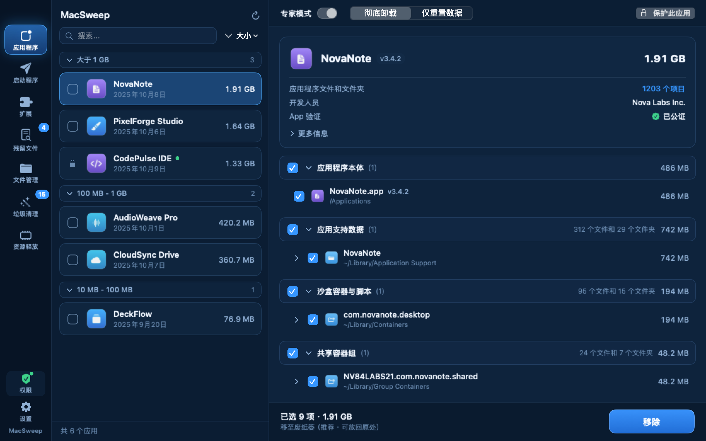<br>
      <sub><b>应用程序（简体中文）</b> — 分桶体积、服务文件与双模式</sub>
    </td>
    <td align="center" width="50%">
      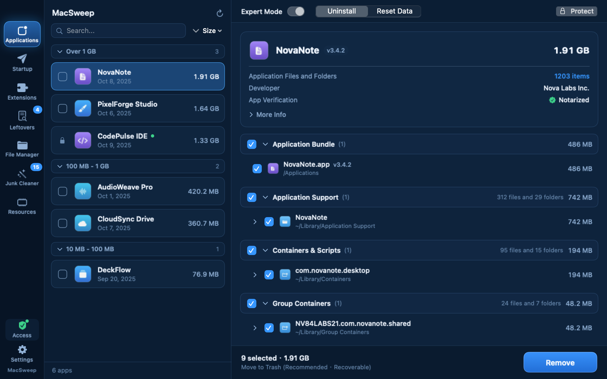<br>
      <sub><b>Applications (EN)</b> — 深海蓝暗色与服务文件明细</sub>
    </td>
  </tr>
  <tr>
    <td align="center" width="50%">
      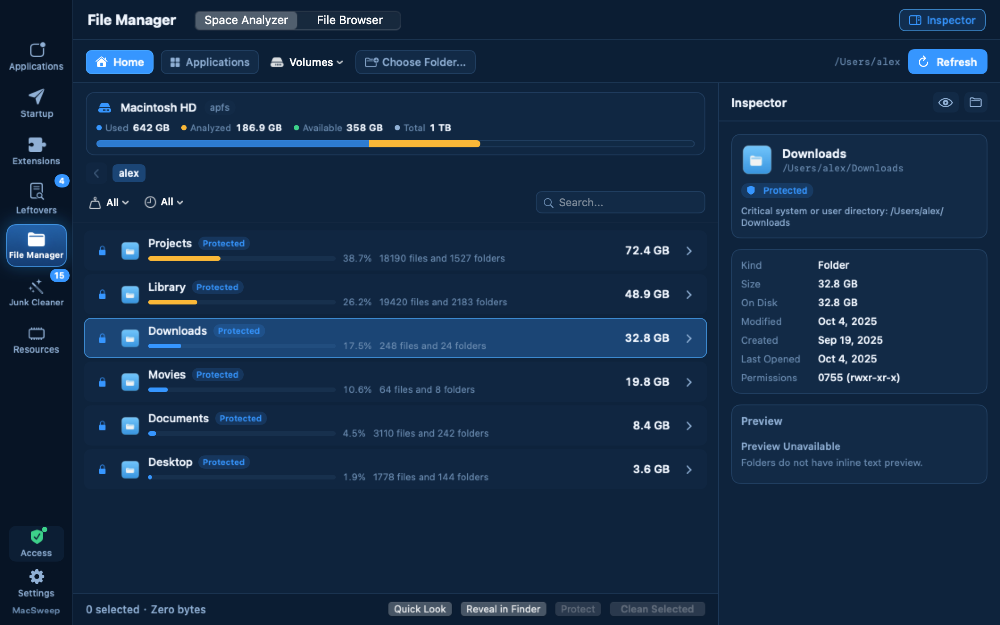<br>
      <sub><b>文件管理 · 空间分析</b> — 卷容量条与目录占用占比下钻</sub>
    </td>
    <td align="center" width="50%">
      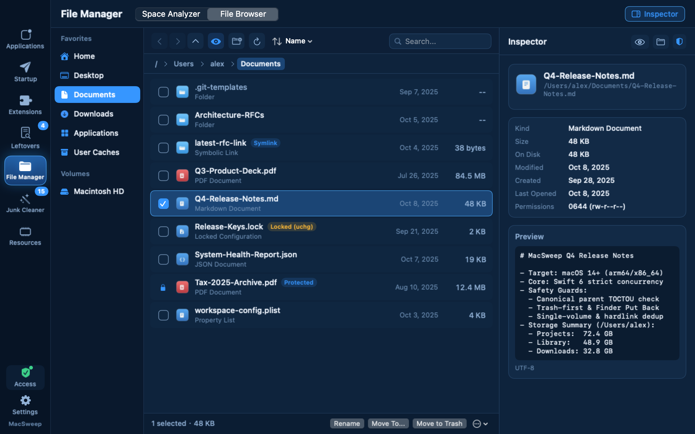<br>
      <sub><b>文件管理 · 文件浏览</b> — 文件操作与右侧限流内容检查器</sub>
    </td>
  </tr>
  <tr>
    <td align="center" width="50%">
      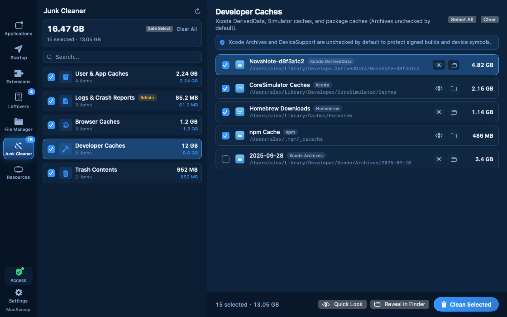<br>
      <sub><b>垃圾清理</b> — 五大缓存/日志/开发/废纸篓分类与安全隔离</sub>
    </td>
    <td align="center" width="50%">
      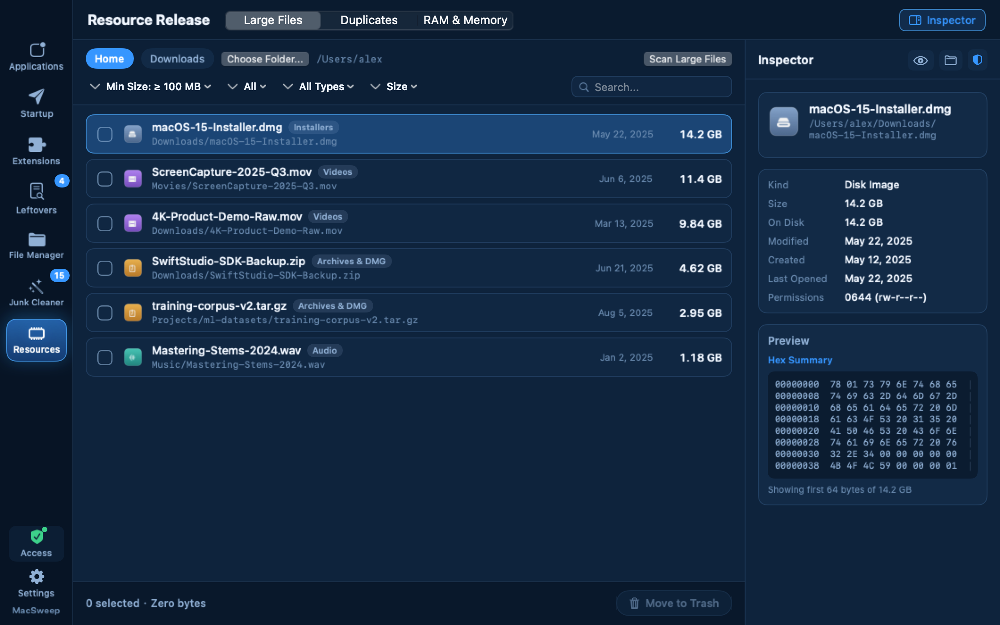<br>
      <sub><b>资源释放 · 大文件排查</b> — 阈值/时间/类型多维筛选</sub>
    </td>
  </tr>
  <tr>
    <td align="center" width="50%">
      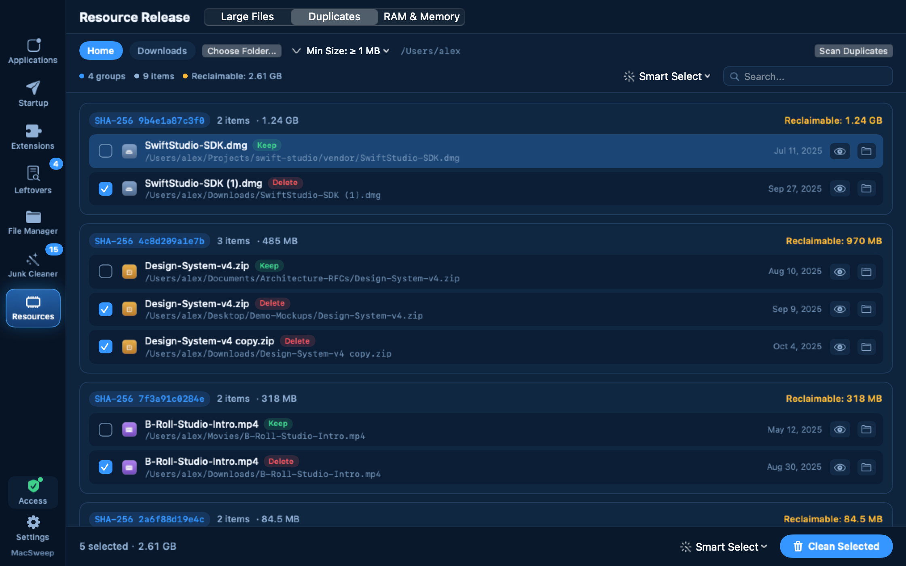<br>
      <sub><b>资源释放 · 重复文件</b> — 三阶段 SHA-256 与智能保留一份</sub>
    </td>
    <td align="center" width="50%">
      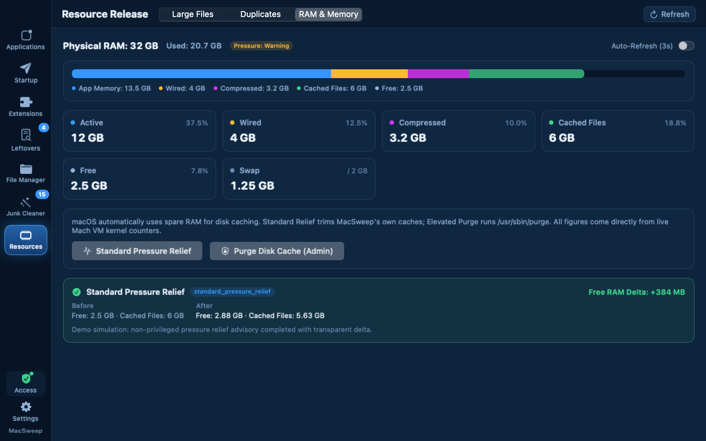<br>
      <sub><b>资源释放 · 内存释放</b> — Mach VM 采样与前后差值反馈</sub>
    </td>
  </tr>
  <tr>
    <td align="center" width="50%">
      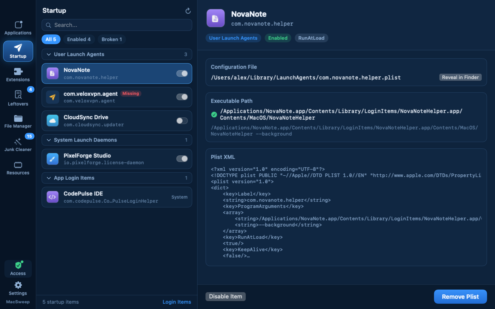<br>
      <sub><b>启动程序</b> — LaunchAgents/Daemons、僵尸检测与 Plist 预览</sub>
    </td>
    <td align="center" width="50%">
      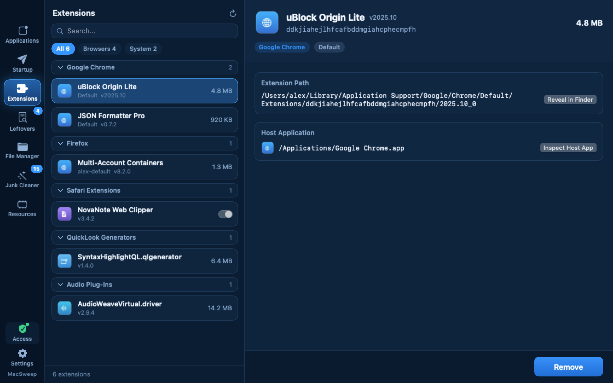<br>
      <sub><b>扩展管理</b> — 浏览器扩展、.appex 与系统音频插件</sub>
    </td>
  </tr>
  <tr>
    <td align="center" width="50%">
      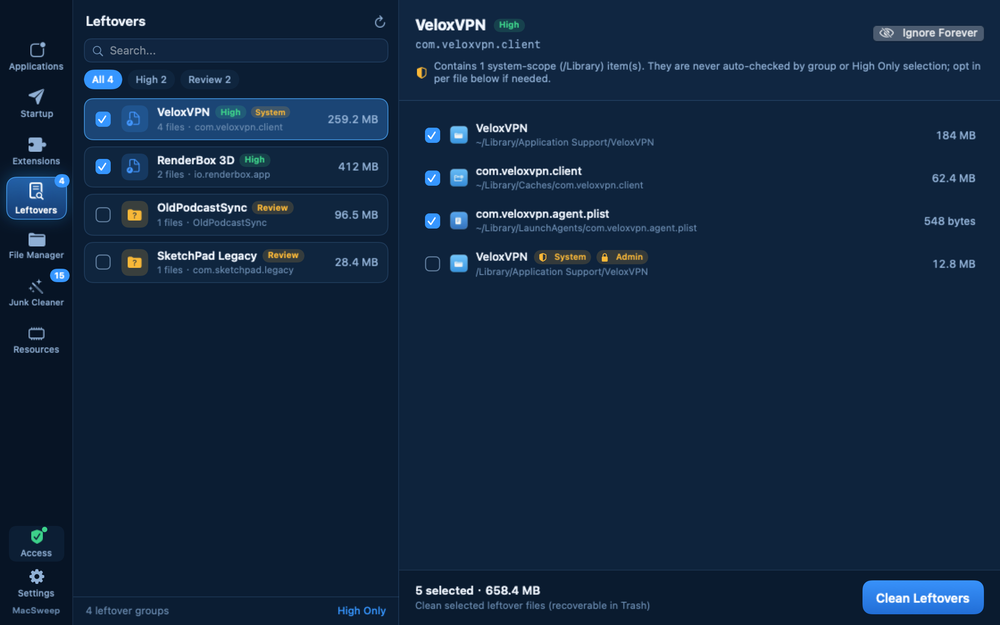<br>
      <sub><b>残留文件</b> — 高置信度与系统级孤立残留识别</sub>
    </td>
    <td align="center" width="50%">
      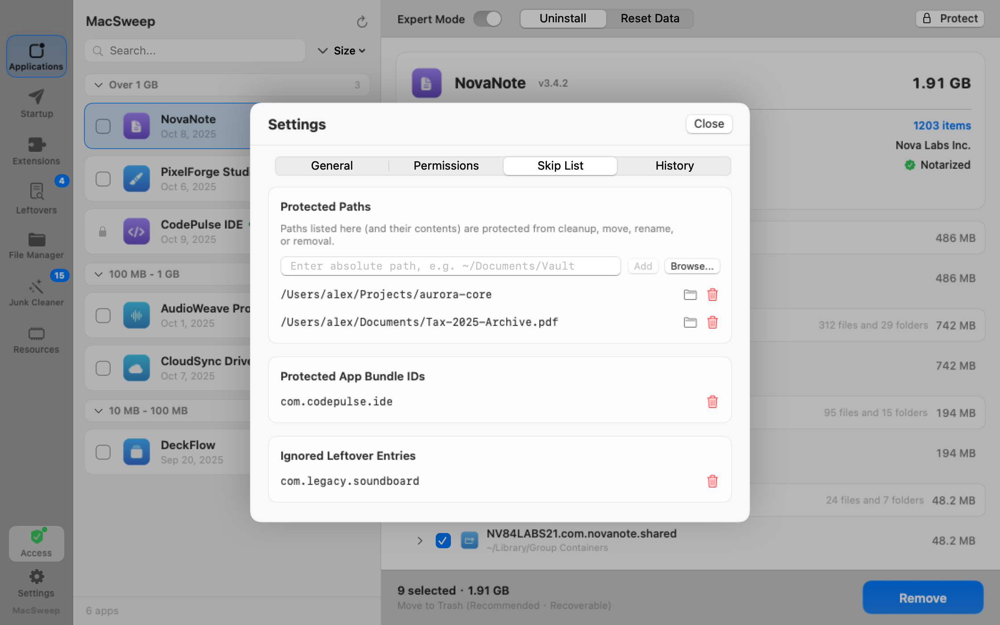<br>
      <sub><b>设置 · 保护名单（浅色主题）</b> — Skip List 路径保护管理</sub>
    </td>
  </tr>
</table>

---

## 4. 快速开始与源码构建

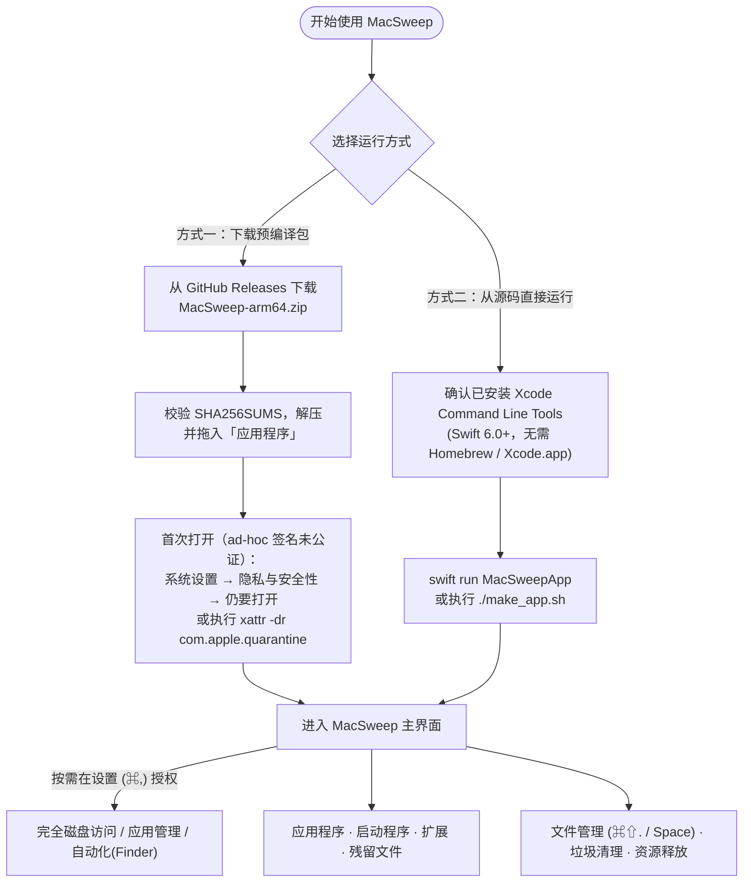

### 方式一：下载预编译包直接运行（Apple Silicon `arm64`）

每次推送 `main` 分支，CI 都会自动构建并发布经过校验的 Preview Release：

```bash
TAG=$(gh release list --repo ChingYung717/MacSweep -L 1 --json tagName -q '.[0].tagName')
gh release download "$TAG" --repo ChingYung717/MacSweep --pattern 'MacSweep-arm64.zip' --pattern 'SHA256SUMS' --pattern 'build-info.txt'
shasum -a 256 --check SHA256SUMS

unzip -q MacSweep-arm64.zip
mv MacSweep.app /Applications/
```

> **首次打开提示**：预编译预览包采用 ad-hoc 签名且未公证（`Signature: ad hoc, not notarized`）。首次启动若遇到 macOS Gatekeeper 拦截，可在「**系统设置 → 隐私与安全性**」底部点击「**仍要打开**」，或在终端执行：
> ```bash
> xattr -dr com.apple.quarantine /Applications/MacSweep.app
> open /Applications/MacSweep.app
> ```

### 方式二：源码构建、测试与演示模式（支持 `macOS 14.0+`）

仅需 macOS Command Line Tools（Swift 6.0+），无需 Homebrew 或完整 `Xcode.app`：

```bash
# 编译并运行 144 项沙盒与回归校验
swift run MacSweepChecks

# 执行只读本机巡检（不修改任何文件）
swift run MacSweepChecks --live-audit

# 运行独立端到端验证套件（154 项严格 E2E 校验）
./Tests/MacSweepE2E/run_e2e.sh --strict --tier all

# 直接启动图形界面
swift run MacSweepApp

# 以脱敏演示模式启动（/Users/alex 虚构数据 + 合成图标，零真实磁盘读写）
swift run MacSweepApp --demo-mode --demo-tab fileManager --demo-lang zh --demo-theme deepOcean

# 离屏导出 2x Retina 脱敏截图到 docs/screenshots/
swift run MacSweepApp --demo-mode --export-screenshots docs/screenshots
```

### 打包独立应用 (`MacSweep.app`)

```bash
./make_app.sh
```

输出产物位于 `dist/MacSweep.app` 与 `dist/MacSweep-<架构>.zip`。脚本默认自动查找本机钥匙串中的 `Apple Development` 证书签名以保持 TCC 权限稳定，无证书或指定 `MACSWEEP_SIGN_IDENTITY="-"` 时使用 ad-hoc 签名；正式分发时可配置 `MACSWEEP_SIGN_IDENTITY`（Developer ID Application）与 `MACSWEEP_NOTARY_PROFILE` 进行公证。

---

## 5. 快捷键与本地配置

- **快捷键**：
  - `⌘,`：打开「设置」（通用与外观、系统权限、保护名单 `protectedPaths`、清理历史）
  - `⌘⇧.`：在文件浏览器中切换隐藏文件显示
  - `Space`：对当前选中文件触发原生 QuickLook 预览
  - `Esc` / `↩`：取消 / 确认清理弹窗（永久删除 `.permanent` 模式下禁用 `↩` 回车默认确认以防误触）
- **配置文件位置**：`~/Library/Application Support/MacSweep/`
  - `preferences.json`：保存视觉主题、界面语言、默认删除方式、扫描范围、保护路径、保护应用 Bundle ID 与永久忽略残留名单；
  - `history.json`：保留最近 100 条清理记录及每次移除的精确路径。

---

## 6. 开源协议、规划文档与安全策略

本项目基于 **[MIT License](./LICENSE)** 开源；完整架构与路线图见 **[docs/PLANNING.md](./docs/PLANNING.md)**，安全模型与删除边界说明详见 **[SECURITY.md](./SECURITY.md)**，参与贡献请参阅 **[CONTRIBUTING.md](./CONTRIBUTING.md)**。
