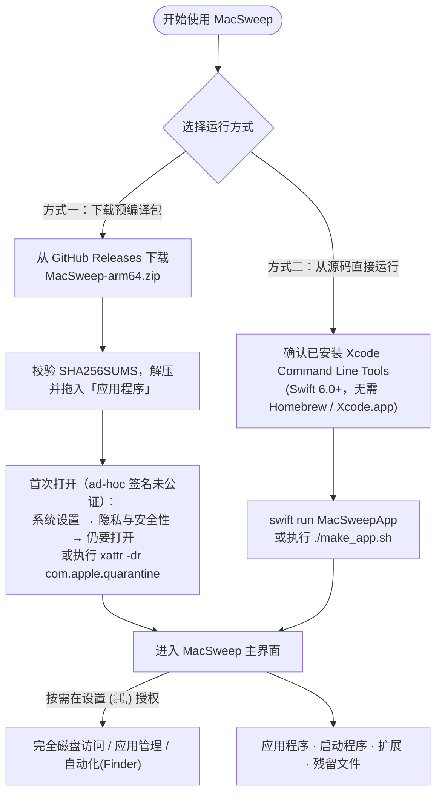

# MacSweep（简体中文详细文档）

<p align="left">
  <a href="./README.md">中英双语主文档 (README.md)</a> ·
  <a href="./README_EN.md">English Documentation (README_EN.md)</a> ·
  <a href="./LICENSE">MIT 开源协议</a> ·
  <a href="./SECURITY.md">安全策略 (SECURITY.md)</a>
</p>

**MacSweep** 是面向 macOS 14+ 的原生应用卸载与系统清理工具，基于纯 **Swift 6、SwiftUI 与 AppKit** 构建，通过 SwiftPM 管理工程，零第三方运行时依赖、零后台常驻进程、零网络遥测。

---

## 1. 模块划分与工程结构

```text
MacSweep/
├── Package.swift                       # SwiftPM 包配置（macOS 14+，Swift 6.0，零外部依赖）
├── Resources/
│   └── AppIcon-1024.png                # 深海蓝应用图标源图（构建时自动生成 AppIcon.icns）
├── Sources/
│   ├── MacSweepCore/                   # 纯 Swift 核心引擎库（可独立测试）
│   │   ├── Models/                     # AppItem / ServiceFile / StartupItem / ExtensionItem / LeftoverItem / Preferences / CleanupRecord
│   │   ├── Scanners/                   # LibraryIndex / AppScanner / ServiceFileMatcher / DirectorySizer / StartupScanner / ExtensionScanner / LeftoverScanner
│   │   ├── Actions/                    # RemovalEngine / PrivilegedExecutor / StartupController / ProcessRunner
│   │   └── Safety/                     # SafetyGuard / PermissionChecker
│   └── MacSweepApp/                    # 原生 macOS SwiftUI 桌面端
│       ├── MacSweepApp.swift           # 应用入口、Dock 拖放处理与菜单快捷键
│       ├── State/                      # AppState / Localization / Theme
│       ├── Views/                      # ApplicationsView / StartupProgramsView / ExtensionsView / LeftoversView / MainSplitView / SettingsSheet
│       └── Components/                 # SidebarRail / DropZoneHeroView / ConfirmationSheet / FileRowView / AppIconView
├── Tests/
│   └── MacSweepChecks/                 # 29 项沙盒与回归校验套件（含 --live-audit 只读巡检）
├── scripts/
│   ├── generate_icon.swift             # 图标生成器
│   └── publish_preview.sh              # GitHub Releases 预览包发布与校验脚本
└── make_app.sh                         # 独立 .app 打包、自动版本递增、签名与 zip 归档脚本
```

---

## 2. 功能一览

| 功能模块 | 核心能力 | 安全与边界保护 |
|---|---|---|
| **应用程序 (`Applications`)** | 扫描已安装应用；一次性 `LibraryIndex` 索引 + `pkgutil` 懒查关联服务文件；按体积分组折叠与异步测算；支持彻底卸载、仅重置应用数据（含 `cfprefsd` 清理）、批量卸载与拖放任意 `.app` 分析 | 隐藏/只读保护受 SIP 或系统卷保护的内置应用；共享同一 Bundle ID 的多副本默认不勾选服务文件；过滤通用运行时（如 `Electron`）与跨应用重名目录；运行中应用仅温和退出，超时后由用户显式决定是否强退 |
| **启动程序 (`Startup`)** | 覆盖 `~/Library/LaunchAgents`、`/Library/LaunchAgents`、`/Library/LaunchDaemons` 与应用内嵌登录项；融合 `launchctl print-disabled` 真实状态；支持启停切换、XML/二进制 plist 预览与僵尸启动项排查 | 拒绝通过 `launchctl` 修改 `com.apple.*` 与内嵌登录项；删除启动项 plist 前先执行 `launchctl bootout` 并重试校验服务不再加载，仍存活则保留 plist |
| **扩展 (`Extensions`)** | 统一管理 Chrome / Edge / Brave / Arc / Firefox / Safari 浏览器扩展、第三方 `.appex` 应用扩展（`pluginkit`）以及偏好面板、QuickLook、Spotlight、屏保、互联网与音频插件（含 HAL） | 内嵌 `.appex` 禁止单独删除以免破坏宿主签名，支持直接开关或跳转宿主应用；未获完全磁盘访问权限时优雅降级提示；删除 Chromium 扩展前检测对应浏览器运行状态；HAL 音频驱动附带重启提示 |
| **残留文件 (`Leftovers`)** | 构建全机已安装应用指纹库（含 `InfoPlist.strings` 本地化名称、UUID 后缀），按「高置信度 / 建议核对」分级展示孤立残留并支持永久忽略 | 自动排除 macOS 内置 `launchd` 服务、Apple 系统目录、常见开发工具/CLI 目录及共享厂商父目录；系统级目录与共享厂商 SDK 上限为「建议核对」且默认不勾选 |

---

## 3. 快速开始与源码构建



### 方式一：下载预编译包直接运行（Apple Silicon `arm64`）

每次推送 `main` 分支，CI 都会自动构建并发布经过校验的 Preview Release：

```bash
TAG=$(gh release list --repo ChingYung717/MacSweep -L 1 --json tagName -q '.[0].tagName')
gh release download "$TAG" --repo ChingYung717/MacSweep --pattern 'MacSweep-arm64.zip' --pattern 'SHA256SUMS' --pattern 'build-info.txt'
shasum -a 256 --check SHA256SUMS

unzip -q MacSweep-arm64.zip
mv MacSweep.app /Applications/
```

> **首次打开提示**：预编译预览包采用 ad-hoc 签名且未公证（`Signature: ad hoc, not notarized`）。首次启动若遇到 macOS Gatekeeper 拦截，可在「**系统设置 → 隐私与安全性**」底部点击「**仍要打开**」，或在终端执行：
> ```bash
> xattr -dr com.apple.quarantine /Applications/MacSweep.app
> open /Applications/MacSweep.app
> ```

### 方式二：源码构建与运行（支持 `macOS 14.0+`）

仅需 macOS Command Line Tools（Swift 6.0+），无需 Homebrew 或完整 Xcode.app：

```bash
# 编译并运行 29 项沙盒与回归校验
swift run MacSweepChecks

# 执行只读本机巡检（不修改任何文件）
swift run MacSweepChecks --live-audit

# 直接启动图形界面
swift run MacSweepApp
```

### 打包独立应用 (`MacSweep.app`)

```bash
./make_app.sh
```

输出产物位于 `dist/MacSweep.app` 与 `dist/MacSweep-<架构>.zip`。脚本默认自动查找本机钥匙串中的 `Apple Development` 证书签名以保持 TCC 权限稳定，无证书或指定 `MACSWEEP_SIGN_IDENTITY="-"` 时使用 ad-hoc 签名；正式分发时可配置 `MACSWEEP_SIGN_IDENTITY`（Developer ID Application）与 `MACSWEEP_NOTARY_PROFILE` 进行公证。

---

## 4. 快捷键与本地配置

- **快捷键**：
  - `⌘,`：打开「设置」（通用与外观、系统权限、保护名单、清理历史）
  - `Esc` / `↩`：取消 / 确认清理弹窗
- **配置文件位置**：`~/Library/Application Support/MacSweep/`
  - `preferences.json`：保存视觉主题、界面语言、默认删除方式、扫描范围、保护应用 Bundle ID 与永久忽略残留名单；
  - `history.json`：保留最近 100 条清理记录及每次移除的精确路径。

---

## 5. 开源协议与安全策略

本项目基于 **[MIT License](./LICENSE)** 开源；安全模型与删除边界说明详见 **[SECURITY.md](./SECURITY.md)**，参与贡献请参阅 **[CONTRIBUTING.md](./CONTRIBUTING.md)**。
